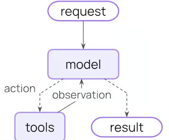
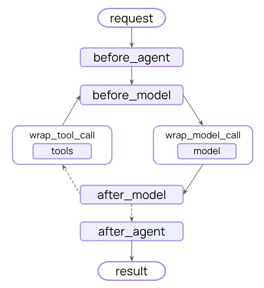

import Tabs from '@theme/Tabs';
import TabItem from '@theme/TabItem';

# Context engineering

## 概览

构建agent(或任何LLM应用程序)的难点在于使其足够可靠。虽然它们可能适用于原型，但在现实世界的用例中经常失败。

### Why do agents fail?

当agent失败时，通常是因为agent内部的LLM调用采取了错误的操作/没有做我们期望的事情。LLM失败的原因有两个：
1. 基础LLM的能力不足
2. “正确”的上下文未传递给LLM

通常情况下，这实际上是导致agent不可靠的第二个原因。

**Context engineering**是以正确的格式提供正确的信息和工具，以便LLM能够完成任务。这是人工智能工程师的首要任务。缺乏“正确”的上下文是更可靠agent的头号障碍，
LangChain的agent抽象是为了促进上下文工程而独特设计的。

### The agent loop

典型的agent循环由两个主要步骤组成：
1. **Model call** -使用提示词和可用工具调用LLM，返回响应或执行工具的请求
2. **Tool execution** -执行LLM请求的工具，返回工具结果

<center>  </center>

这个循环一直持续到LLM决定结束。


### What you can control

为了构建可靠的agent，您需要控制agent循环的每一步发生的事情，以及步骤之间发生的事情。

| Context Type | What You Control | Transient/Persistent |
|---|---|---|
| Model Context      |  What goes into model calls (instructions, message history, tools, response format)  | Transient  |
| Tool Context       |  What tools can access and produce (reads/writes to state, store, runtime context)   | Persistent |
| Life-cycle Context |  What happens between model and tool calls (summarization, guardrails, logging, etc.)| Persistent |

- Transient context: LLM从call看到的。你可以修改消息、工具或提示词，而无需更改状态中保存的内容。
- Persistent context： 在多轮对话中存活的东西。生命周期hook和工具写入会永久修改的东西。

很明显，就是持久和瞬态。这里把context的内容划分为3类；

### Data sources

在整个过程中，你的agent访问(读取/写入)不同的数据源：

| Data Source | Also Known As | Scope | Examples  |
|---|---|---|---|
| Runtime Context |  Static configuration  |  Conversation-scoped   | User ID, API keys, database connections, permissions, environment settings |
| State           |  Short-term memory     |  Conversation-scoped   | Current messages, uploaded files, authentication status, tool results      |
| Store           |  Long-term memory      |  Cross-conversation    | User preferences, extracted insights, memories, historical data            |

很明显，这就是前面的Tool context的内容， 它们在多轮对话里存活。

### How it works

LangChain中间件是底层机制，它使使用LangChain的开发人员能够实现上下文工程。中间件允许你挂接到agent生命周期中的任何步骤：
- Update context
- Jump to a different step in the agent lifecycle

在本指南中，你将看到频繁使用中间件API作为实现上下文工程的一种手段。

## Model context

控制每个模型调用的内容——指令、可用工具、使用哪个模型以及输出格式。这些决定直接影响可靠性和成本。
- System prompt: 开发人员向LLM发送的基本指令。
- Message:   发送到LLM的消息（对话历史）的完整列表。
- Tools:  agent可以访问的实用程序以执行操作。
- Model:  要调用的实际模型（包括配置）。
- Response Format: 模型最终响应的模式规范。

所有这些类型的模型上下文都可以从State(短期记忆)、Store(长期记忆)或runtime context(静态配置)中提取。

### System Prompt

系统提示词设置LLM的行为和功能。不同的用户、上下文或对话阶段需要不同的指令。成功的agent利用记忆、偏好和配置为对话的当前状态提供正确的指令。

<Tabs>
  <TabItem value="State" label="State" default>   
    从State访问message数量或对话上下文：
    ```python
    from langchain.agents import create_agent
    from langchain.agents.middleware import dynamic_prompt, ModelRequest

    @dynamic_prompt
    def state_aware_prompt(request: ModelRequest) -> str:
        # request.messages is a shortcut for request.state["messages"]
        message_count = len(request.messages)
        base = "You are a helpful assistant."
        if message_count > 10:
            base += "\nThis is a long conversation - be extra concise."
        return base
    agent = create_agent(
        model="gpt-5.5",
        tools=[...],
        middleware=[state_aware_prompt]
    )
    ```
  </TabItem>
  <TabItem value="Store" label="Store">
    从长期记忆中访问用户偏好：
    ```python
    from dataclasses import dataclass
    from langchain.agents import create_agent
    from langchain.agents.middleware import dynamic_prompt, ModelRequest
    from langgraph.store.memory import InMemoryStore

    @dataclass
    class Context:
        user_id: str

    @dynamic_prompt
    def store_aware_prompt(request: ModelRequest) -> str:
        user_id = request.runtime.context.user_id
        # Read from Store: get user preferences
        store = request.runtime.store
        user_prefs = store.get(("preferences",), user_id)
        base = "You are a helpful assistant."
        if user_prefs:
            style = user_prefs.value.get("communication_style", "balanced")
            base += f"\nUser prefers {style} responses."
        return base

    agent = create_agent(
        model="gpt-5.5",
        tools=[...],
        middleware=[store_aware_prompt],
        context_schema=Context,
        store=InMemoryStore()
    )
    ```
  </TabItem>
  <TabItem value="Runtime Context" label="Runtime Context">
    从运行时上下文访问用户ID或配置：
    ```python
    from dataclasses import dataclass
    from langchain.agents import create_agent
    from langchain.agents.middleware import dynamic_prompt, ModelRequest

    @dataclass
    class Context:
        user_role: str
        deployment_env: str

    @dynamic_prompt
    def context_aware_prompt(request: ModelRequest) -> str:
        # Read from Runtime Context: user role and environment
        user_role = request.runtime.context.user_role
        env = request.runtime.context.deployment_env
        base = "You are a helpful assistant."
        if user_role == "admin":
            base += "\nYou have admin access. You can perform all operations."
        elif user_role == "viewer":
            base += "\nYou have read-only access. Guide users to read operations only."
        if env == "production":
            base += "\nBe extra careful with any data modifications."
        return base

    agent = create_agent(
        model="gpt-5.5",
        tools=[...],
        middleware=[context_aware_prompt],
        context_schema=Context
    )
    ```
  </TabItem>
</Tabs>

### Messages

Messages构成了发送到LLM的prompt。管理消息内容以确保LLM拥有正确的信息来做出良好响应至关重要。

<Tabs>
  <TabItem value="State" label="State" default>   
    当与当前查询相关时，从State注入上传的文件上下文：
    ```python
    from langchain.agents import create_agent
    from langchain.agents.middleware import wrap_model_call, ModelRequest, ModelResponse
    from typing import Callable

    @wrap_model_call
    def inject_file_context(request: ModelRequest, handler: Callable[[ModelRequest], ModelResponse] ) -> ModelResponse:
        """Inject context about files user has uploaded this session."""
        # Read from State: get uploaded files metadata
        uploaded_files = request.state.get("uploaded_files", [])
        if uploaded_files:
            # Build context about available files
            file_descriptions = []
            for file in uploaded_files:
                file_descriptions.append(
                    f"- {file['name']} ({file['type']}): {file['summary']}"
                )
            file_context = f"""Files you have access to in this conversation:{chr(10).join(file_descriptions)}Reference these files when answering questions."""

            # Inject file context before recent messages
            messages = [
                *request.messages,
                {"role": "user", "content": file_context},
            ]
            request = request.override(messages=messages)
        return handler(request)

    agent = create_agent(
        model="gpt-5.5",
        tools=[...],
        middleware=[inject_file_context]
    )
    ```
  </TabItem>
  <TabItem value="Store" label="Store">
    从store注入用户的电子邮件写作风格以指导起草：
    ```python
    from dataclasses import dataclass
    from langchain.agents import create_agent
    from langchain.agents.middleware import wrap_model_call, ModelRequest, ModelResponse
    from typing import Callable
    from langgraph.store.memory import InMemoryStore

    @dataclass
    class Context:
        user_id: str

    @wrap_model_call
    def inject_writing_style( request: ModelRequest, handler: Callable[[ModelRequest], ModelResponse]) -> ModelResponse:
        """Inject user's email writing style from Store."""
        user_id = request.runtime.context.user_id  

        # Read from Store: get user's writing style examples
        store = request.runtime.store  
        writing_style = store.get(("writing_style",), user_id)

        if writing_style:
            style = writing_style.value
            # Build style guide from stored examples
            style_context = f"""Your writing style: - Tone: {style.get('tone', 'professional')} - Typical greeting: "{style.get('greeting', 'Hi')}"
                - Typical sign-off: "{style.get('sign_off', 'Best')}"  - Example email you've written: {style.get('example_email', '')}"""

            # Append at end - models pay more attention to final messages
            messages = [
                *request.messages,
                {"role": "user", "content": style_context}
            ]
            request = request.override(messages=messages)
        return handler(request)

    agent = create_agent(
        model="gpt-5.5",
        tools=[...],
        middleware=[inject_writing_style],
        context_schema=Context,
        store=InMemoryStore()
    )
    ```
  </TabItem>
  <TabItem value="Runtime Context" label="Runtime Context">
    根据用户的权限从运行时上下文注入合规规则：
    ```python
    from dataclasses import dataclass
    from langchain.agents import create_agent
    from langchain.agents.middleware import wrap_model_call, ModelRequest, ModelResponse
    from typing import Callable

    @dataclass
    class Context:
        user_jurisdiction: str
        industry: str
        compliance_frameworks: list[str]

    @wrap_model_call
    def inject_compliance_rules( request: ModelRequest, handler: Callable[[ModelRequest], ModelResponse] ) -> ModelResponse:
        """Inject compliance constraints from Runtime Context."""
        # Read from Runtime Context: get compliance requirements
        jurisdiction = request.runtime.context.user_jurisdiction  
        industry = request.runtime.context.industry  
        frameworks = request.runtime.context.compliance_frameworks  

        # Build compliance constraints
        rules = []
        if "GDPR" in frameworks:
            rules.append("- Must obtain explicit consent before processing personal data")
            rules.append("- Users have right to data deletion")
        if "HIPAA" in frameworks:
            rules.append("- Cannot share patient health information without authorization")
            rules.append("- Must use secure, encrypted communication")
        if industry == "finance":
            rules.append("- Cannot provide financial advice without proper disclaimers")
        if rules:
            compliance_context = f"""Compliance requirements for {jurisdiction}:{chr(10).join(rules)}"""

            # Append at end - models pay more attention to final messages
            messages = [
                *request.messages,
                {"role": "user", "content": compliance_context}
            ]
            request = request.override(messages=messages)
        return handler(request)

    agent = create_agent(
        model="gpt-5.5",
        tools=[...],
        middleware=[inject_compliance_rules],
        context_schema=Context
    )
    ```
  </TabItem>
</Tabs>

瞬时消息更新与持久消息更新：上面的示例使用wrap_model_call进行瞬态更新——修改单个调用发送到模型的消息，而不更改状态中保存的内容。

对于修改状态的持久更新，你可以：
- 从wrap_model_call返回带有command的ExtendedModelResponse，以从模型调用层注入状态更新。
- 使用生命周期hooks，如before_model、after_model或wrap_tool_call（用于工具返回）来更新对话历史记录。有关更多详细信息，请参阅中间件文档。

### Tools

tools允许模型与数据库、API和外部系统交互。如何定义和选择工具直接影响模型能否有效地完成任务。

#### Define tools
    
每个tool都需要一个明确的名称、描述、参数名称和参数描述。这些不仅仅是元数据——它们指导模型关于何时以及如何使用该工具的推理。
```python
from langchain.tools import tool

@tool(parse_docstring=True)
def search_orders( user_id: str, status: str, limit: int = 10 ) -> str:
    """Search for user orders by status.

    Use this when the user asks about order history or wants to check
    order status. Always filter by the provided status.

    Args:
        user_id: Unique identifier for the user
        status: Order status: 'pending', 'shipped', or 'delivered'
        limit: Maximum number of results to return
    """
    # Implementation here
    pass
```

#### Selecting tools

并非每种工具都适合每种情况。太多的工具可能会淹没模型（过载上下文）并增加错误；太少限制了能力。动态工具选择根据身份验证状态、用户权限、功能标志或对话阶段调整可用工具集。

<Tabs>
  <TabItem value="State" label="State" default>
    仅在某些对话里程碑之后启用高级tools：
    ```python
    from langchain.agents import create_agent
    from langchain.agents.middleware import wrap_model_call, ModelRequest, ModelResponse
    from typing import Callable

    @wrap_model_call
    def state_based_tools( request: ModelRequest, handler: Callable[[ModelRequest], ModelResponse] ) -> ModelResponse:
        """Filter tools based on conversation State."""
        # Read from State: check if user has authenticated
        state = request.state  
        is_authenticated = state.get("authenticated", False)
        message_count = len(state["messages"])

        # Only enable sensitive tools after authentication
        if not is_authenticated:
            tools = [t for t in request.tools if t.name.startswith("public_")]
            request = request.override(tools=tools)
        elif message_count < 5:
            # Limit tools early in conversation
            tools = [t for t in request.tools if t.name != "advanced_search"]
            request = request.override(tools=tools)
        return handler(request)

    agent = create_agent(
        model="gpt-5.5",
        tools=[public_search, private_search, advanced_search],
        middleware=[state_based_tools]
    )
    ```
  </TabItem>
  <TabItem value="Store" label="Store">
    基于用户偏好或store中的功能标志筛选tool：
    ```python
    from dataclasses import dataclass
    from langchain.agents import create_agent
    from langchain.agents.middleware import wrap_model_call, ModelRequest, ModelResponse
    from typing import Callable
    from langgraph.store.memory import InMemoryStore

    @dataclass
    class Context:
        user_id: str

    @wrap_model_call
    def store_based_tools( request: ModelRequest, handler: Callable[[ModelRequest], ModelResponse] ) -> ModelResponse:
        """Filter tools based on Store preferences."""
        user_id = request.runtime.context.user_id

        # Read from Store: get user's enabled features
        store = request.runtime.store
        feature_flags = store.get(("features",), user_id)

        if feature_flags:
            enabled_features = feature_flags.value.get("enabled_tools", [])
            # Only include tools that are enabled for this user
            tools = [t for t in request.tools if t.name in enabled_features]
            request = request.override(tools=tools)
        return handler(request)

    agent = create_agent(
        model="gpt-5.5",
        tools=[search_tool, analysis_tool, export_tool],
        middleware=[store_based_tools],
        context_schema=Context,
        store=InMemoryStore()
    )
    ```
  </TabItem>
  <TabItem value="Runtime Context" label="Runtime Context">
    根据运行时上下文中的用户权限筛选工具：
    ```python
    from dataclasses import dataclass
    from langchain.agents import create_agent
    from langchain.agents.middleware import wrap_model_call, ModelRequest, ModelResponse
    from typing import Callable

    @dataclass
    class Context:
       user_role: str

    @wrap_model_call
    def context_based_tools( request: ModelRequest, handler: Callable[[ModelRequest], ModelResponse] ) -> ModelResponse:
        """Filter tools based on Runtime Context permissions."""
        # Read from Runtime Context: get user role
        user_role = request.runtime.context.user_role
        if user_role == "admin":
            # Admins get all tools
            pass
        elif user_role == "editor":
            # Editors can't delete
            tools = [t for t in request.tools if t.name != "delete_data"]
            request = request.override(tools=tools)
        else:
            # Viewers get read-only tools
            tools = [t for t in request.tools if t.name.startswith("read_")]
            request = request.override(tools=tools)
        return handler(request)

    agent = create_agent(
        model="gpt-5.5",
        tools=[read_data, write_data, delete_data],
        middleware=[context_based_tools],
        context_schema=Context
    )
    ```
  </TabItem>
</Tabs>
  
有关过滤预注册工具和在运行时（例如从MCP服务器）注册工具的信息，请参阅Dynamic tools。

### Model

不同的模型具有不同的优势、成本和上下文窗口。为手头的任务选择正确的模型，这可能会在agent运行期间发生变化。
<Tabs>
  <TabItem value="State" label="State" default>
    根据State的对话长度使用不同的模型：：
    ```python
    from langchain.agents import create_agent
    from langchain.agents.middleware import wrap_model_call, ModelRequest, ModelResponse
    from langchain.chat_models import init_chat_model
    from typing import Callable

    # Initialize models once outside the middleware
    large_model = init_chat_model("claude-sonnet-4-6")
    standard_model = init_chat_model("gpt-5.5")
    efficient_model = init_chat_model("gpt-5.4-mini")

    @wrap_model_call
    def state_based_model(request: ModelRequest, handler: Callable[[ModelRequest], ModelResponse] ) -> ModelResponse:
        """Select model based on State conversation length."""
        # request.messages is a shortcut for request.state["messages"]
        message_count = len(request.messages)
        if message_count > 20:
            # Long conversation - use model with larger context window
            model = large_model
        elif message_count > 10:
            # Medium conversation
            model = standard_model
        else:
            # Short conversation - use efficient model
            model = efficient_model
        request = request.override(model=model)
        return handler(request)

    agent = create_agent(
        model="gpt-5.4-mini",
        tools=[...],
        middleware=[state_based_model]
    )
    ```
  </TabItem>
  <TabItem value="Store" label="Store">
    使用用户在store中的首选型号：
    ```python
    from dataclasses import dataclass
    from langchain.agents import create_agent
    from langchain.agents.middleware import wrap_model_call, ModelRequest, ModelResponse
    from langchain.chat_models import init_chat_model
    from typing import Callable
    from langgraph.store.memory import InMemoryStore

    @dataclass
    class Context:
        user_id: str

    # Initialize available models once
    MODEL_MAP = {
        "gpt-5.5": init_chat_model("gpt-5.5"),
        "gpt-5.4-mini": init_chat_model("gpt-5.4-mini"),
        "claude-sonnet": init_chat_model("claude-sonnet-4-6"),
    }

    @wrap_model_call
    def store_based_model(request: ModelRequest, handler: Callable[[ModelRequest], ModelResponse] ) -> ModelResponse:
        """Select model based on Store preferences."""
        user_id = request.runtime.context.user_id
        # Read from Store: get user's preferred model
        store = request.runtime.store
        user_prefs = store.get(("preferences",), user_id)

        if user_prefs:
            preferred_model = user_prefs.value.get("preferred_model")
            if preferred_model and preferred_model in MODEL_MAP:
                request = request.override(model=MODEL_MAP[preferred_model])
        return handler(request)

    agent = create_agent(
        model="gpt-5.5",
        tools=[...],
        middleware=[store_based_model],
        context_schema=Context,
        store=InMemoryStore()
    )
    ```
  </TabItem>
  <TabItem value="Runtime Context" label="Runtime Context">
    从运行时上下文中根据成本限制或环境选择模型：
    ```python
    from dataclasses import dataclass
    from langchain.agents import create_agent
    from langchain.agents.middleware import wrap_model_call, ModelRequest, ModelResponse
    from langchain.chat_models import init_chat_model
    from typing import Callable

    @dataclass
    class Context:
        cost_tier: str
        environment: str

    # Initialize models once outside the middleware
    premium_model = init_chat_model("claude-sonnet-4-6")
    standard_model = init_chat_model("gpt-5.5")
    budget_model = init_chat_model("gpt-5.4-mini")

    @wrap_model_call
    def context_based_model(request: ModelRequest, handler: Callable[[ModelRequest], ModelResponse] ) -> ModelResponse:
        """Select model based on Runtime Context."""
        # Read from Runtime Context: cost tier and environment
        cost_tier = request.runtime.context.cost_tier
        environment = request.runtime.context.environment
        if environment == "production" and cost_tier == "premium":
            # Production premium users get best model
            model = premium_model
        elif cost_tier == "budget":
            # Budget tier gets efficient model
            model = budget_model
        else:
            # Standard tier
            model = standard_model
        request = request.override(model=model)
        return handler(request)

    agent = create_agent(
        model="gpt-5.5",
        tools=[...],
        middleware=[context_based_model],
        context_schema=Context
    )
    ```
  </TabItem>
</Tabs> 

更多示例请参见 Dynamic model 

### Response format

结构化输出将非结构化文本转换为经过验证的结构化数据。在为下游系统提取特定字段或返回数据时，自由格式的文本是不够的。

工作原理：当您提供schema作为响应格式时，模型的最终响应保证符合该模式。agent运行模型/工具调用循环，直到模型调用工具完成，然后将最终响应强制转换为提供的格式。

#### Defining formats

模式定义指导模型。字段名、类型和描述确切地指定了输出应遵循的格式。
```python
from pydantic import BaseModel, Field

class CustomerSupportTicket(BaseModel):
    """Structured ticket information extracted from customer message."""

    category: str = Field(
        description="Issue category: 'billing', 'technical', 'account', or 'product'"
    )
    priority: str = Field(
        description="Urgency level: 'low', 'medium', 'high', or 'critical'"
    )
    summary: str = Field(
        description="One-sentence summary of the customer's issue"
    )
    customer_sentiment: str = Field(
        description="Customer's emotional tone: 'frustrated', 'neutral', or 'satisfied'"
    )
```

#### Selecting formats

动态响应格式选择根据用户偏好、对话阶段或角色调整schema——随着复杂性的增加，尽早返回简单格式和详细格式。
<Tabs>
  <TabItem value="State" label="State" default>
    根据对话状态配置结构化输出：
    ```python
    from langchain.agents import create_agent
    from langchain.agents.middleware import wrap_model_call, ModelRequest, ModelResponse
    from pydantic import BaseModel, Field
    from typing import Callable

    class SimpleResponse(BaseModel):
        """Simple response for early conversation."""
        answer: str = Field(description="A brief answer")

    class DetailedResponse(BaseModel):
        """Detailed response for established conversation."""
        answer: str = Field(description="A detailed answer")
        reasoning: str = Field(description="Explanation of reasoning")
        confidence: float = Field(description="Confidence score 0-1")

    @wrap_model_call
    def state_based_output(request: ModelRequest,handler: Callable[[ModelRequest], ModelResponse] ) -> ModelResponse:
        """Select output format based on State."""
        # request.messages is a shortcut for request.state["messages"]
        message_count = len(request.messages)
        if message_count < 3:
            # Early conversation - use simple format
            request = request.override(response_format=SimpleResponse)
        else:
            # Established conversation - use detailed format
            request = request.override(response_format=DetailedResponse)
        return handler(request)

    agent = create_agent(
        model="gpt-5.5",
        tools=[...],
        middleware=[state_based_output]
    )
    ```
  </TabItem>
  <TabItem value="Store" label="Store">
    在Store中根据用户偏好配置输出格式：
    ```python
    from dataclasses import dataclass
    from langchain.agents import create_agent
    from langchain.agents.middleware import wrap_model_call, ModelRequest, ModelResponse
    from pydantic import BaseModel, Field
    from typing import Callable
    from langgraph.store.memory import InMemoryStore

    @dataclass
    class Context:
        user_id: str

    class VerboseResponse(BaseModel):
        """Verbose response with details."""
        answer: str = Field(description="Detailed answer")
        sources: list[str] = Field(description="Sources used")

    class ConciseResponse(BaseModel):
        """Concise response."""
        answer: str = Field(description="Brief answer")

    @wrap_model_call
    def store_based_output( request: ModelRequest, handler: Callable[[ModelRequest], ModelResponse] ) -> ModelResponse:
        """Select output format based on Store preferences."""
        user_id = request.runtime.context.user_id
        # Read from Store: get user's preferred response style
        store = request.runtime.store
        user_prefs = store.get(("preferences",), user_id)
        if user_prefs:
            style = user_prefs.value.get("response_style", "concise")
            if style == "verbose":
                request = request.override(response_format=VerboseResponse)
            else:
                request = request.override(response_format=ConciseResponse)
        return handler(request)

    agent = create_agent(
        model="gpt-5.5",
        tools=[...],
        middleware=[store_based_output],
        context_schema=Context,
        store=InMemoryStore()
    )
    ```
  </TabItem>
  <TabItem value="Runtime Context" label="Runtime Context">
    根据运行时上下文（如用户角色或环境）配置输出格式：
    ```python
    from dataclasses import dataclass
    from langchain.agents import create_agent
    from langchain.agents.middleware import wrap_model_call, ModelRequest, ModelResponse
    from pydantic import BaseModel, Field
    from typing import Callable

    @dataclass
    class Context:
        user_role: str
        environment: str

    class AdminResponse(BaseModel):
        """Response with technical details for admins."""
        answer: str = Field(description="Answer")
        debug_info: dict = Field(description="Debug information")
        system_status: str = Field(description="System status")

    class UserResponse(BaseModel):
        """Simple response for regular users."""
        answer: str = Field(description="Answer")

    @wrap_model_call
    def context_based_output( request: ModelRequest, handler: Callable[[ModelRequest], ModelResponse] ) -> ModelResponse:
        """Select output format based on Runtime Context."""
        # Read from Runtime Context: user role and environment
        user_role = request.runtime.context.user_role
        environment = request.runtime.context.environment

        if user_role == "admin" and environment == "production":
            # Admins in production get detailed output
            request = request.override(response_format=AdminResponse)
        else:
            # Regular users get simple output
            request = request.override(response_format=UserResponse)
        return handler(request)

    agent = create_agent(
        model="gpt-5.5",
        tools=[...],
        middleware=[context_based_output],
        context_schema=Context
    )
    ```
  </TabItem>
</Tabs> 

## Tool context

tool的特殊之处在于它们既能读也能写上下文。

在最基本的情况下，当tool执行时，它会接收LLM的请求参数并返回 tool message。该工具完成其工作并产生结果。
tool还可以获取模型的重要信息，使其能够执行和完成任务。

### Reads

大多数现实世界的tool需要的不仅仅是LLM的参数。他们需要数据库查询的用户ID、外部服务的API密钥或当前会话状态来做出决策。工具从State、Store和runtime context读取以访问此信息。
<Tabs>
  <TabItem value="State" label="State" default>
    从State读取以检查当前会话信息：
    ```python
    from langchain.tools import tool, ToolRuntime
    from langchain.agents import create_agent

    @tool
    def check_authentication( runtime: ToolRuntime) -> str:
        """Check if user is authenticated."""
        # Read from State: check current auth status
        current_state = runtime.state
        is_authenticated = current_state.get("authenticated", False)

        if is_authenticated:
            return "User is authenticated"
        else:
            return "User is not authenticated"

    agent = create_agent(
        model="gpt-5.5",
        tools=[check_authentication]
    )
    ```
  </TabItem>
  <TabItem value="Store" label="Store">
    从Store读取以访问持久的用户首偏好：
    ```python
    from dataclasses import dataclass
    from langchain.tools import tool, ToolRuntime
    from langchain.agents import create_agent
    from langgraph.store.memory import InMemoryStore

    @dataclass
    class Context:
        user_id: str

    @tool
    def get_preference( preference_key: str, runtime: ToolRuntime[Context] ) -> str:
        """Get user preference from Store."""
        user_id = runtime.context.user_id

        # Read from Store: get existing preferences
        store = runtime.store
        existing_prefs = store.get(("preferences",), user_id)

        if existing_prefs:
            value = existing_prefs.value.get(preference_key)
            return f"{preference_key}: {value}" if value else f"No preference set for {preference_key}"
        else:
            return "No preferences found"

    agent = create_agent(
        model="gpt-5.5",
        tools=[get_preference],
        context_schema=Context,
        store=InMemoryStore()
    )
    ```
  </TabItem>
  <TabItem value="Runtime Context" label="Runtime Context">
    从运行时上下文中读取API密钥和用户ID等配置：
    ```python
    from dataclasses import dataclass
    from langchain.tools import tool, ToolRuntime
    from langchain.agents import create_agent

    @dataclass
    class Context:
        user_id: str
        api_key: str
        db_connection: str

    @tool
    def fetch_user_data( query: str, runtime: ToolRuntime[Context] ) -> str:
        """Fetch data using Runtime Context configuration."""
        # Read from Runtime Context: get API key and DB connection
        user_id = runtime.context.user_id
        api_key = runtime.context.api_key
        db_connection = runtime.context.db_connection

        # Use configuration to fetch data
        results = perform_database_query(db_connection, query, api_key)

        return f"Found {len(results)} results for user {user_id}"

    agent = create_agent(
        model="gpt-5.5",
        tools=[fetch_user_data],
        context_schema=Context
    )

    # Invoke with runtime context
    result = agent.invoke(
        {"messages": [{"role": "user", "content": "Get my data"}]},
        context=Context(
            user_id="user_123",
            api_key="sk-...",
            db_connection="postgresql://..."
        )
    )
    ```
  </TabItem>
</Tabs> 

### Writes

工具结果可用于帮助代理完成给定的任务。工具既可以直接将结果返回给模型，也可以更新agent的memory，以便为未来的步骤提供重要的上下文。
<Tabs>
  <TabItem value="State" label="State" default>
    使用command向State写入以跟踪会话特定信息：
    ```python
    from langchain.tools import tool, ToolRuntime
    from langchain.agents import create_agent
    from langgraph.types import Command

    @tool
    def authenticate_user( password: str, runtime: ToolRuntime ) -> Command:
        """Authenticate user and update State."""
        # Perform authentication (simplified)
        if password == "correct":
            # Write to State: mark as authenticated using Command
            return Command(
                update={"authenticated": True},
            )
        else:
            return Command(update={"authenticated": False})

    agent = create_agent(
        model="gpt-5.5",
        tools=[authenticate_user]
    )
    ```
  </TabItem>
  <TabItem value="Store" label="Store">
    写入Store以跨会话持久化数据：
    ```python
    from dataclasses import dataclass
    from langchain.tools import tool, ToolRuntime
    from langchain.agents import create_agent
    from langgraph.store.memory import InMemoryStore

    @dataclass
    class Context:
        user_id: str

    @tool
    def save_preference(
        preference_key: str,
        preference_value: str,
        runtime: ToolRuntime[Context]
    ) -> str:
        """Save user preference to Store."""
        user_id = runtime.context.user_id
        # Read existing preferences
        store = runtime.store
        existing_prefs = store.get(("preferences",), user_id)
        # Merge with new preference
        prefs = existing_prefs.value if existing_prefs else {}
        prefs[preference_key] = preference_value
        # Write to Store: save updated preferences
        store.put(("preferences",), user_id, prefs)
        return f"Saved preference: {preference_key} = {preference_value}"

    agent = create_agent(
        model="gpt-5.5",
        tools=[save_preference],
        context_schema=Context,
        store=InMemoryStore()
    )
    ```
  </TabItem>
</Tabs> 

有关在tool中访问State、Store和runtime context的综合示例，请参阅工具。

## Life-cycle context

控制核心agent步骤之间发生的事情——拦截数据流以实现跨领域关注点，如摘要、guardrails和日志记录。

正如你在模型上下文和工具上下文中看到的，中间件是使上下文工程实用的机制。中间件允许你hook到agent生命周期中的任何步骤，并且：
1. 更新上下文-修改State和Store以保存更改、更新对话历史或保存见解
2. 生命周期中的跳转-根据上下文移动到agent周期中的不同步骤（例如，如果满足条件，则跳过工具执行，使用修改后的上下文重复模型调用）

<center>  </center>

### Example: Summarization

最常见的生命周期模式之一是当对话历史过长时自动压缩对话历史。 
与模型上下文中显示的瞬态消息修剪不同，摘要会持续更新状态——用为所有未来轮次保存的摘要永久替换旧消息。

LangChain为此提供了内置中间件：

```python
from langchain.agents import create_agent
from langchain.agents.middleware import SummarizationMiddleware

agent = create_agent(
    model="gpt-5.5",
    tools=[...],
    middleware=[
        SummarizationMiddleware(
            model="gpt-5.4-mini",
            trigger={"tokens": 4000},
            keep=("messages", 20),
        ),
    ],
)
```

当对话超过token限制时，Summary Middleware会自动：
1. 使用单独的LLM调用汇总旧message
2. 在State中用摘要消息替换它们(永久)
3. 保持最近消息的完整性以供上下文使用

摘要的对话历史记录将永久更新-未来的对话回合将看到摘要，而不是原始消息。

## 最佳实践
1. 从简单开始-从静态prompt和tool开始，只在需要时添加动态
2. 增量测试-一次添加一个上下文工程功能
3. 监控性能-跟踪模型调用、token使用和延迟
4. 使用内置中间件-利用SummarizationMiddleware、LLMToolSelectorMiddleware等。
5. 记录你的上下文策略——明确传递的上下文及其原因
6. 了解瞬态与持久性：模型上下文更改是瞬态的（每次调用），而生命周期上下文更改会持久化到State
