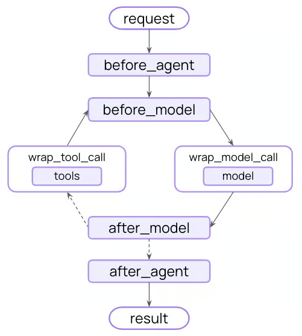

# Guardrails

Guardrails(护栏)通过在agent执行的关键点验证和过滤内容，帮助您构建安全、合规的AI应用程序。它们可以检测敏感信息，执行内容策略，验证输出，并在不安全行为造成问题之前加以预防。

常见用例包括：
- 防止PII泄漏
- 检测和阻止即时注入攻击
- 阻止不适当或有害的内容
- 执行业务规则和合规要求
- 验证输出质量和准确性

你可以使用中间件实现护栏，在战略点拦截执行——在agent启动之前、完成之后，或者在模型和工具调用周围。

  

Guardrails可以使用两种互补的方法来实现：
- Deterministic guardrails: 使用基于规则的逻辑，如正则表达式模式、关键字匹配或显式检查。快速、可预测且具有成本效益，但可能会错过细微的违规行为。
- Model-based guardrails: 使用LLM或分类器来评估具有语义理解的内容。捕捉规则遗漏的微妙问题，但速度较慢，成本更高。

LangChain提供了内置的护栏（例如PII检测、human-in-the-loop）和灵活的中间件系统，用于使用任何一种方法构建自定义护栏。

## Built-in guardrails

### PII detection

LangChain提供了内置的中间件，用于检测和处理对话中的个人身份信息（PII）。该中间件可以检测常见的PII类型，如电子邮件、信用卡、IP地址等。

PII检测中间件对于具有合规要求的医疗保健和金融应用程序、需要清理日志的客户服务agent以及通常处理敏感用户数据的任何应用程序等情况都很有帮助。

PII中间件支持多种策略来处理检测到的PII：

|Strategy | Description  | Example |
|---|---|---|
|redact | Replace with [REDACTED_{'PII_TYPE'}]     |  [REDACTED_EMAIL]      | 
|mask   | Partially obscure (e.g., last 4 digits)  | ****-****-****-1234    |
|hash   | Replace with deterministic hash          | a8f5f167...            |
|block  | Raise exception when detected            | Error thrown           |

有关PII检测功能的完整详细信息，请参阅中间件文档。

## Custom guardrails

## Additional resources

