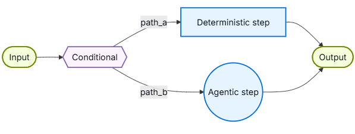

import Tabs from '@theme/Tabs';
import TabItem from '@theme/TabItem';

# Custom workflow

在自定义工作流架构中，你可以使用LangGraph定义自己的定制执行流。你可以完全控制图结构，包括顺序步骤、条件分支、循环和并行执行。
<center>  </center> 

## Key characteristics

- 完全控制图形结构
- 将确定性逻辑与agent行为相结合
- 支持顺序步骤、条件分支、循环和并行执行
- 将其他模式作为节点嵌入到工作流中

## When to use

当标准模式(subagents、skills等)不符合你的要求，你需要将确定性逻辑与agent行为混合，或者你的用例需要复杂的路由或多阶段处理时，请使用自定义工作流。

工作流中的每个节点都可以是一个简单的函数、LLM调用或带有工具的整个agent。你还可以在自定义工作流中组合其他架构，例如，将multi-agent系统嵌入为单个节点。

## Basic implementation

核心观点是，你可以在任何LangGraph节点内直接调用LangChain agent，将自定义工作流的灵活性与预构建agent的便利性相结合：
```python
from langchain.agents import create_agent
from langgraph.graph import StateGraph, START, END

agent = create_agent(model="openai:gpt-5.5", tools=[...])

def agent_node(state: State) -> dict:
    """A LangGraph node that invokes a LangChain agent."""
    result = agent.invoke({
        "messages": [{"role": "user", "content": state["query"]}]
    })
    return {"answer": result["messages"][-1].content}

# Build a simple workflow
workflow = (
    StateGraph(State)
    .add_node("agent", agent_node)
    .add_edge(START, "agent")
    .add_edge("agent", END)
    .compile()
)
```

## Example: RAG pipeline
一个常见的用例是将检索与agent相结合。此示例构建了一个WNBA统计助手，该助手从知识库中检索并可以获取实时新闻。
