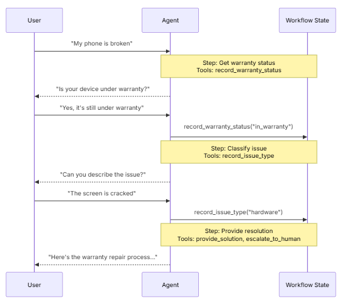

import Tabs from '@theme/Tabs';
import TabItem from '@theme/TabItem';

# Handoffs

在切换架构中，行为会根据State动态变化。核心机制是：工具更新一个State变量(例如，current_step或active_agent)，该变量在循环中持续存在，
系统读取该变量以调整行为——要么应用不同的配置(system prompt, tools)，要么路由到不同的agent。此模式支持不同agent之间的切换和单个agent内的动态配置更改。

交接(Handoffs)一词是由OpenAI创造的，用于使用tool调用（例如transfer_to_sales_agent）在agent或state之间转移控制权。
<center>  </center> 

## Key characteristics

- State-driven behavior：基于状态变量（例如current_step或active_agent）的行为变化
- Tool-based transitions: 工具更新状态变量以在状态之间移动
- Direct user interaction：每个State的配置直接处理用户message
- Persistent state: State在会话中幸存下来

## When to use

当你需要强制执行顺序约束(仅在满足先决条件后解锁功能)，agent需要在不同状态下直接与用户对话，或者你正在构建多阶段会话流时，请使用handoffs模式。
这种模式对于需要按特定顺序收集信息的客户支持场景特别有价值，例如，在处理退款之前收集保修ID。

## Basic implementation

核心机制是一个返回command以更新状态的tool，触发向新步骤或代理的转换：
```python
from langchain.tools import tool
from langchain.messages import ToolMessage
from langgraph.types import Command

@tool
def transfer_to_specialist(runtime) -> Command:
    """Transfer to the specialist agent."""
    return Command(
        update={
            "messages": [
                ToolMessage(
                    content="Transferred to specialist",
                    tool_call_id=runtime.tool_call_id  
                )
            ],
            "current_step": "specialist"  # Triggers behavior change
        }
    )
```

为什么要包含ToolMessage？当LLM调用工具时，它期望得到响应。具有匹配tool_call_id的ToolMessage完成了这个请求-响应循环——没有它，对话历史就会变得格式错误。
每当你的handoff tool更新消息时，都需要这样做。

## Implementation approaches

有两种方法可以实现handoffs：使用中间件的单个agent(一个agent具有动态配置)或多个agent subgraph(不同的agent作为图节点)。

### Single agent with middleware

单个agent根据State改变其行为。中间件拦截每个模型调用，并动态调整system prompt和可用tools。工具更新State变量以触发转换：
```python
from langchain.tools import ToolRuntime, tool
from langchain.messages import ToolMessage
from langgraph.types import Command

@tool
def record_warranty_status(
    status: str,
    runtime: ToolRuntime[None, SupportState]
) -> Command:
    """Record warranty status and transition to next step."""
    return Command(
        update={
            "messages": [
                ToolMessage(
                    content=f"Warranty status recorded: {status}",
                    tool_call_id=runtime.tool_call_id
                )
            ],
            "warranty_status": status,
            "current_step": "specialist"  # Update state to trigger transition
        }
    )
```

### Multiple agent subgraphs

多个不同的agent作为单独的节点存在于图中。Handoff tools使用Command在agent节点之间导航。Command.PARENT指定下一个要执行的节点。

子图切换需要仔细的上下文工程。与单agent中间件(消息历史自然流动)不同，你必须明确决定agent之间传递的消息。如果弄错了，agent将收到格式错误的对话历史记录或臃肿的上下文。请参阅下面的上下文工程。

```python
from langchain.messages import AIMessage, ToolMessage
from langchain.tools import tool, ToolRuntime
from langgraph.types import Command

@tool
def transfer_to_sales(
    runtime: ToolRuntime,
) -> Command:
    """Transfer to the sales agent."""
    last_ai_message = next(
        msg for msg in reversed(runtime.state["messages"]) if isinstance(msg, AIMessage)
    )
    transfer_message = ToolMessage(
        content="Transferred to sales agent",
        tool_call_id=runtime.tool_call_id,
    )
    return Command(
        goto="sales_agent",
        update={
            "active_agent": "sales_agent",
            "messages": [last_ai_message, transfer_message],
        },
        graph=Command.PARENT
    )
```

此示例显示了一个具有分开销售和支持agent的多agent系统。每个agent都是一个单独的图节点，handoff tools允许agent相互传输对话。
```python
from typing import Literal

from langchain.agents import AgentState, create_agent
from langchain.messages import AIMessage, ToolMessage
from langchain.tools import tool, ToolRuntime
from langgraph.graph import StateGraph, START, END
from langgraph.types import Command
from typing_extensions import NotRequired


# 1. Define state with active_agent tracker
class MultiAgentState(AgentState):
    active_agent: NotRequired[str]


# 2. Create handoff tools
@tool
def transfer_to_sales(
    runtime: ToolRuntime,
) -> Command:
    """Transfer to the sales agent."""
    last_ai_message = next(
        msg for msg in reversed(runtime.state["messages"]) if isinstance(msg, AIMessage)
    )
    transfer_message = ToolMessage(
        content="Transferred to sales agent from support agent",
        tool_call_id=runtime.tool_call_id,
    )
    return Command(
        goto="sales_agent",
        update={
            "active_agent": "sales_agent",
            "messages": [last_ai_message, transfer_message],
        },
        graph=Command.PARENT,
    )


@tool
def transfer_to_support(
    runtime: ToolRuntime,
) -> Command:
    """Transfer to the support agent."""
    last_ai_message = next(
        msg for msg in reversed(runtime.state["messages"]) if isinstance(msg, AIMessage)
    )
    transfer_message = ToolMessage(
        content="Transferred to support agent from sales agent",
        tool_call_id=runtime.tool_call_id,
    )
    return Command(
        goto="support_agent",
        update={
            "active_agent": "support_agent",
            "messages": [last_ai_message, transfer_message],
        },
        graph=Command.PARENT,
    )


# 3. Create agents with handoff tools
sales_agent = create_agent(
    model="google_genai:gemini-3.6-flash",
    tools=[transfer_to_support],
    system_prompt="You are a sales agent. Help with sales inquiries. If asked about technical issues or support, transfer to the support agent.",
)

support_agent = create_agent(
    model="google_genai:gemini-3.6-flash",
    tools=[transfer_to_sales],
    system_prompt="You are a support agent. Help with technical issues. If asked about pricing or purchasing, transfer to the sales agent.",
)


# 4. Create agent nodes that invoke the agents
def call_sales_agent(state: MultiAgentState) -> Command:
    """Node that calls the sales agent."""
    response = sales_agent.invoke(state)
    return response


def call_support_agent(state: MultiAgentState) -> Command:
    """Node that calls the support agent."""
    response = support_agent.invoke(state)
    return response


# 5. Create router that checks if we should end or continue
def route_after_agent(
    state: MultiAgentState,
) -> Literal["sales_agent", "support_agent", "__end__"]:
    """Route based on active_agent, or END if the agent finished without handoff."""
    messages = state.get("messages", [])

    # Check the last message - if it's an AIMessage without tool calls, we're done
    if messages:
        last_msg = messages[-1]
        if isinstance(last_msg, AIMessage) and not last_msg.tool_calls:
            return "__end__"

    # Otherwise route to the active agent
    active = state.get("active_agent", "sales_agent")
    return active if active else "sales_agent"


def route_initial(
    state: MultiAgentState,
) -> Literal["sales_agent", "support_agent"]:
    """Route to the active agent based on state, default to sales agent."""
    return state.get("active_agent") or "sales_agent"


# 6. Build the graph
builder = StateGraph(MultiAgentState)
builder.add_node("sales_agent", call_sales_agent)
builder.add_node("support_agent", call_support_agent)

# Start with conditional routing based on initial active_agent
builder.add_conditional_edges(START, route_initial, ["sales_agent", "support_agent"])

# After each agent, check if we should end or route to another agent
builder.add_conditional_edges(
    "sales_agent", route_after_agent, ["sales_agent", "support_agent", END]
)
builder.add_conditional_edges(
    "support_agent", route_after_agent, ["sales_agent", "support_agent", END]
)

graph = builder.compile()
result = graph.invoke(
    {
        "messages": [
            {
                "role": "user",
                "content": "Hi, I'm having trouble with my account login. Can you help?",
            }
        ]
    }
)

for msg in result["messages"]:
    msg.pretty_print()
```

####  Context engineering

通过子图切换，你可以精确控制agent之间的消息流。这种精度对于维护有效的对话历史记录和避免可能混淆下游agent的上下文膨胀至关重要。有关此主题的更多信息，请参阅上下文工程。

Handling context during handoffs

在agent之间切换时，你需要确保对话历史记录仍然有效。LLM希望工具调用与其响应配对，因此在使用Command.parent移交给另一个agent时，你必须同时包括以下两项：
1.  The AIMessage containing the tool call (the message that triggered the handoff)
2.  A ToolMessage acknowledging the handoff (the artificial response to that tool call)

如果没有这种配对，接收agent将看到不完整的对话，并可能产生错误或意外行为。

下面的示例假设只调用了handoff tool(没有并行工具调用)：
```python
@tool
def transfer_to_sales(runtime: ToolRuntime) -> Command:
    # Get the AI message that triggered this handoff
    last_ai_message = runtime.state["messages"][-1]

    # Create an artificial tool response to complete the pair
    transfer_message = ToolMessage(
        content="Transferred to sales agent",
        tool_call_id=runtime.tool_call_id,
    )

    return Command(
        goto="sales_agent",
        update={
            "active_agent": "sales_agent",
            # Pass only these two messages, not the full subagent history
            "messages": [last_ai_message, transfer_message],
        },
        graph=Command.PARENT,
    )
```

为什么不传递所有subagent消息？虽然你可以在切换中包含完整的subagent对话，但这通常会产生问题。接收agent可能会被无关的内部推理弄糊涂，token成本也会不必要地增加。
通过只传递切换对，你可以使父图的上下文专注于高级协调。如果接收agent需要额外的上下文，请考虑在ToolMessage内容中总结subagent的工作，而不是传递原始消息历史记录。

## Implementation considerations

在设计多agent系统时，请考虑：
- Context filtering strategy: 每个agent都会收到完整的对话历史、过滤后的部分或摘要吗？不同的agent可能需要不同的上下文，具体取决于它们的角色
- Tool semantics: 澄清handoff tools是只更新路由状态还是也执行副作用。例如，transfer_to_sales()是否也应该创建一个支持票，或者这应该是一个单独的操作
- Token efficiency: 平衡上下文完整性和token成本。随着对话时间的延长，总结和选择性上下文传递变得越来越重要

