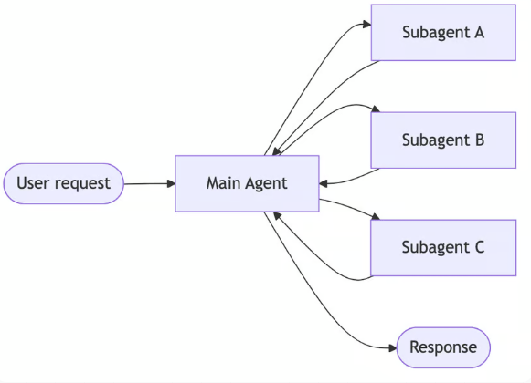
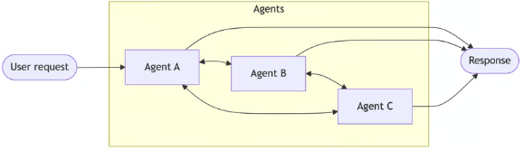
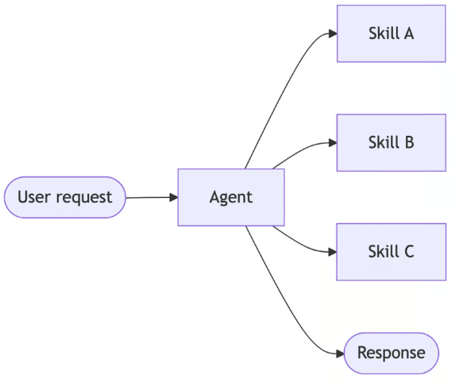
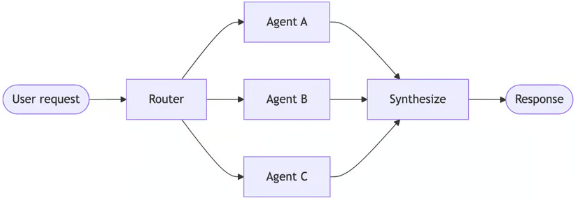
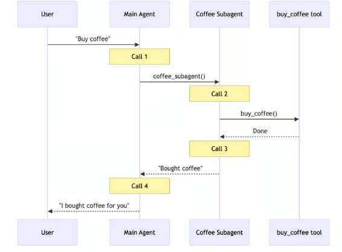
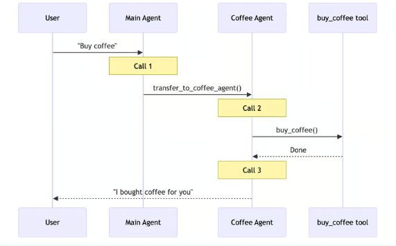
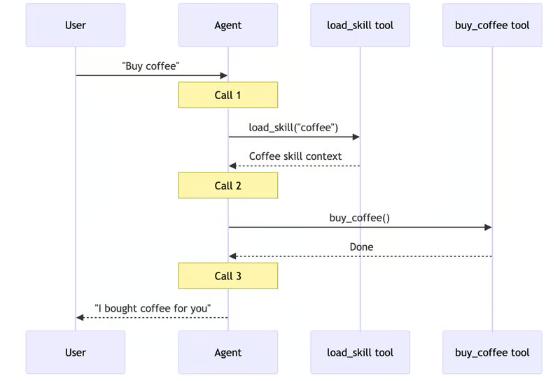
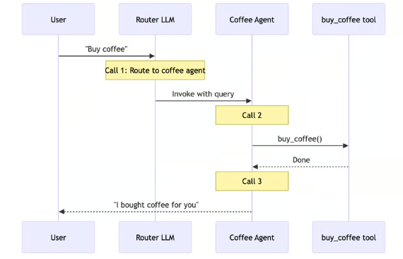

import Tabs from '@theme/Tabs';
import TabItem from '@theme/TabItem';

# Overview

多agent系统协调专门的组件来处理复杂的工作流程。然而，并非所有复杂的任务都需要这种方法——一个拥有正确(有时是动态的)工具和提示词的单一agent通常可以实现类似的结果。

对于内置的多agent支持，请使用Managed Deep Agents：一种基于LangChain构建的托管高级工具，附带subagents、skills、planning、虚拟文件系统和上下文管理。
或者，为了在使用相同的Deep Agents harness时获得最大的灵活性，你可以自己使用Deep Agents和主机代理，或者运行自定义的LangSmith部署。

## Why multi-agent?

当开发人员说他们需要“multi-agent”时，他们通常会寻找以下一种或多种功能：
- Context management：在不淹没模型上下文窗口的情况下提供专业知识。如果上下文是无限的，延迟为零，你可以将所有知识转储到一个提示词中——但由于不是这样，
                      你需要模式来选择性地显示相关信息。
- Distributed development：允许不同的团队独立开发和维护功能，将它们组合成一个具有明确边界的更大系统。
- Parallelization: 为子任务培养专门的工作人员，并同时执行它们以获得更快的结果。

当单个agent拥有太多的tool并且对使用哪些工具做出了糟糕的决定时，当任务需要具有广泛背景的专业知识(长提示词和特定于领域的工具)时，或者当你需要强制执行顺序约束，
只有在满足某些条件后才能解锁功能时，multi-agent模式尤其有价值。

多智能体设计的核心是上下文工程——决定每个智能体看到什么信息。系统的质量取决于确保每个agent都能访问其任务所需的正确数据。

## Patterns

以下是构建multi-agent系统的主要模式，每种模式都适用于不同的用例：
| Pattern | How it works |
|---|---|
| Subagents      | main agent将subagent作为工具进行协调。所有路由都通过main agent，main agent决定何时以及如何调用每个subagent。 |
| Handoffs       | 行为会根据State动态变化。工具调用会更新一个状态变量，该变量会触发路由或配置更改、切换agent或调整当前agent的工具和提示词。 |
| Skills         | 按需加载专业提示词和知识。在根据需要从skill加载上下文时，单个agent保持控制。 |
| Router         | 路由步骤对输入进行分类，并将其定向到一个或多个专用agent。结果被合成为一个组合响应。 |
| Custom workflow| 使用LangGraph构建定制的执行流，混合确定性逻辑和代理行为。将其他模式作为节点嵌入到工作流中。 |

### Choosing a pattern

使用此表将你的要求与正确的模式相匹配：
| Pattern    |  Distributed development |  Parallelization | Multi-hop | Direct user interaction |
|---|---|---|---|---|
| Subagents   |  ***** | ***** | ***** |  *    |
| Handoffs    |        |       | ***** | ***** |
| Skills      |  ***** | ***   | ***** | ***** |
| Router      |  ***   | ***** |       |  ***  |

- Distributed development: 不同的团队可以独立维护组件吗？
- Parallelization: 多个agent可以同时执行吗?
- Multi-hop: 该模式是否支持串联调用多个subagent？
- Direct user interaction: subagents可以直接与用户对话吗?

### Visual overview

<Tabs>
  <TabItem value="Subagents" label="Subagents" default>
    main agent 将subagent 作为工具进行协调。所有路由都通过main agent。
    
  
 
  </TabItem>
  <TabItem value="Handoffs" label="Handoffs">
    agent通过工具调用相互转移控制权。每个代理都可以切换给其他代理或直接响应用户。
    
  
 
  </TabItem>
  <TabItem value="Skills" label="Skills">
    单个agent在保持控制的同时按需加载专门的提示词和知识。
    
  
 
  </TabItem>
  <TabItem value="Router" label="Router">
    路由步骤对输入进行分类，并将其定向到专门的agent。结果是综合的。
    
  
 
  </TabItem>
</Tabs>

## Performance comparison

不同的模式具有不同的性能特征。了解这些权衡有助于你为延迟和成本要求选择正确的模式。

关键指标：
- Model calls：LLM调用次数。更多的调用=更高的延迟（尤其是在顺序调用的情况下）和更高的每次请求API成本。
- Tokens processed: 所有调用的上下文token总使用量。更多的token=更高的处理成本和潜在的上下文限制。

### One-shot request

案例： 用户买咖啡

专业的咖啡agent/技能可以调用buy_coffee工具。
| Pattern | Model calls | Best fit  |
|---|---|---|
| Subagents |  4 |        |
| Handoffs  |  3 |  right |
| Skills    |  3 |  right |
| Router    |  3 |  right |

<Tabs>
  <TabItem value="Subagents" label="Subagents" default>
    4 model calls:
    
  
 
  </TabItem>
  <TabItem value="Handoffs" label="Handoffs">
    3 model calls:
    
  
 
  </TabItem>
  <TabItem value="Skills" label="Skills">
    3 model calls:
    
  
 
  </TabItem>
  <TabItem value="Router" label="Router">
    3 model calls:
    
  
 
  </TabItem>
</Tabs>

关键见解：Handoffs, Skills, and Router对于单个任务(每个任务3个呼叫)最有效。subagent增加了一个额外的调用，因为结果通过mainagent返回——这种开销提供了集中控制。

### Repeat request

Turn 1: “Buy coffee” Turn 2: “Buy coffee again”

用户在同一对话中重复相同的请求。

| Pattern | Turn 2 calls | Total (both turns)  |   Best fit |
|---|---|---|---|
| Subagents |  4 | 8 |       |
| Handoffs  |  2 | 5 | right |     
| Skills    |  2 | 5 | right |
| Router    |  3 | 6 |       |

<Tabs>
  <TabItem value="Subagents" label="Subagents" default>
    4 calls again → 8 total
    - subagent的设计是无状态的——每次调用都遵循相同的流程
    - main agent维护对话上下文，但subagent每次都会重新开始
    - 这提供了强大的上下文隔离，但重复了整个流程
  </TabItem>
  <TabItem value="Handoffs" label="Handoffs">
    2 calls → 5 total
    - 从第1回合开始，coffee agent仍然有效(状态持续存在)
    - 无需切换——客服直接调用buy_coffee工具（调用1）
    - agent响应用户（呼叫2）
    - 跳过切换保存1个通话
  </TabItem>
  <TabItem value="Skills" label="Skills">
    2 calls → 5 total
    - skills上下文已加载到对话历史记录中
    - 无需重新加载——代理直接调用buy_coffee工具（调用1）
    - agent响应用户（呼叫2）
    - 通过重用加载的skills保存1次呼叫
  </TabItem>
  <TabItem value="Router" label="Router">
    3 calls again → 6 total
    - router是无状态的——每个请求都需要一个LLM路由调用
    - 第二轮：routerLLM呼叫（1）→milk agent呼叫buy_coffee（2）→milk agent响应（3）
    - 可以通过将包装作为有状态agent中的工具进行优化
  </TabItem>
</Tabs>

关键见解：有State的模式(Handoffs, Skills)可以节省40-50%的重复请求呼叫。subagents保持每个请求的一致成本——这种无状态设计提供了强大的上下文隔离，但代价是重复的模型调用。

### Multi-domain

用户：“比较Python、JavaScript和Rust在web开发中的应用”

每个语言agent/skills包含约2000个文档标记。所有模式都可以进行并行工具调用。

关键见解：对于多域任务，具有并行执行的模式（subagent、Router）是最有效的。由于上下文积累，skills调用较少，但token使用率较高。这里的切换效率很低——它必须按顺序执行，
不能利用并行工具调用同时咨询多个领域。

### Summary

以下是模式在所有三种情况下的比较：
| Pattern | One-shot | Repeat request  | Multi-domain  |
|---|---|---|---|
| Subagents |  4 calls | 8 calls(4+4) | 5 calls, 9K tokens    |
| Handoffs  |  3 calls | 5 calls(3+2) | 7+ calls, 14K+ tokens |     
| Skills    |  3 calls | 5 calls(3+2) | 3 calls, 15K tokens   |
| Router    |  3 calls | 6 calls(3+3) | 5 calls, 9K tokens    |

选择模式：
| Optimize for | Subagents | Handoffs  | Skills | Router |
|---|---|---|---|---|
| Single requests       |       | right | right | right |
| Repeat requests       |       | right | right |       |  
| Parallel execution    | right |       |       | right | 
| Large-context domains | right |       |       | right |
| Simple, focused tasks |       |       | right |       |

