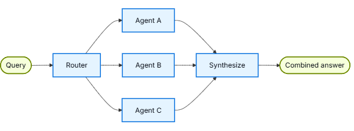

import Tabs from '@theme/Tabs';
import TabItem from '@theme/TabItem';

# Router

在router架构中，router步骤对输入进行分类并将其定向到专用agent。当你有不同的垂直领域（独立的知识领域，每个领域都需要自己的agent）时，这很有用。

<center>  </center> 

## Key characteristics

- Router decomposes the query
- Zero or more specialized agents are invoked in parallel
- Results are synthesized into a coherent response

## When to use

当你有不同的垂直领域（独立的知识领域，每个领域都需要自己的agent），需要并行查询多个来源，并希望将结果合成为组合响应时，请使用router模式。

## Basic implementation

router对查询进行分类，并将其定向到适当的agent。使用Command进行single-agent routing，或使用Send进行多个agent的并行扇出。
<Tabs>
  <TabItem value="Single agent" label="Single agent" default>
    使用command路由到单个专用agent：
    ```python
    from langgraph.types import Command

    def classify_query(query: str) -> str:
        """Use LLM to classify query and determine the appropriate agent."""
        # Classification logic here
        ...

    def route_query(state: State) -> Command:
        """Route to the appropriate agent based on query classification."""
        active_agent = classify_query(state["query"])

        # Route to the selected agent
        return Command(goto=active_agent)   
    ```
  </TabItem>
  <TabItem value="Multiple agents (parallel)" label="Multiple agents (parallel)">
    使用Send可并行向多个专业agent发送：
    ```python
    from typing import TypedDict
    from langgraph.types import Send

    class ClassificationResult(TypedDict):
        query: str
        agent: str

    def classify_query(query: str) -> list[ClassificationResult]:
        """Use LLM to classify query and determine which agents to invoke."""
        # Classification logic here
        ...

    def route_query(state: State):
        """Route to relevant agents based on query classification."""
        classifications = classify_query(state["query"])

        # Fan out to selected agents in parallel
        return [
            Send(c["agent"], {"query": c["query"]})
            for c in classifications
        ]
    ```
  </TabItem>
</Tabs>

## Stateless vs. stateful

两种方法：
- Stateless routers独立处理每个请求
- Stateful routers有状态的路由器维护整个请求的对话历史


## Stateless

每个请求都是独立路由的——调用之间没有记忆。有关多回合对话，请参阅有状态router。

Router vs. Subagents：这两种模式都可以将工作分派给多个agent，但它们在路由决策的方式上有所不同：

- Router：一个专用的路由步骤（通常是单个LLM调用或基于规则的逻辑），对输入进行分类并分派给agent。router本身通常不维护对话历史或执行多回合编排——这是一个预处理步骤。
- Subagents：主监督agent动态决定在正在进行的对话中呼叫哪些subagent。mainagent维护上下文，可以轮流调用多个subagent，并编排复杂的多步骤工作流。

当你有明确的输入类别并希望进行确定性或轻量级分类时，请使用router。当你需要灵活、对话感知的编排时，请使用supervisor，LLM根据不断变化的上下文决定下一步该做什么。


## Stateful

对于多回合会话，你需要在调用之间维护上下文。

### Tool wrapper

最简单的方法是：将stateless router包装为会话agent可以调用的工具。会话agent处理记忆和上下文；router保持无状态。这避免了跨多个并行agent管理会话历史的复杂性。
```python
@tool
def search_docs(query: str) -> str:
    """Search across multiple documentation sources."""
    result = workflow.invoke({"query": query})
    return result["final_answer"]

# Conversational agent uses the router as a tool
conversational_agent = create_agent(
    model,
    tools=[search_docs],
    prompt="You are a helpful assistant. Use search_docs to answer questions."
)
```

### Full persistence

如果你需要router本身来维护状态，请使用持久化来存储消息历史。当路由到agent时，从状态中获取以前的消息，并有选择地将其包含在agent的上下文中——这是上下文工程的一个杠杆。


Stateful routers需要自定义历史管理。如果router在agent之间轮流切换，当agent有不同的音调或提示词时，最终用户可能不会觉得对话流畅。
使用并行调用，你需要在路由级别维护历史记录（输入和合成输出），并在路由逻辑中利用此历史记录。考虑handoffs模式或subagent模式——两者都为多回合对话提供了更清晰的语义。
