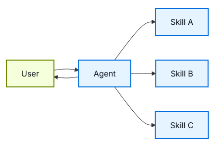

import Tabs from '@theme/Tabs';
import TabItem from '@theme/TabItem';

# Skills

在skills架构中，专职的能力被打包为可调用的“技能”，以增强agent的行为。
skills最初是agent按需调用的由prompt驱动的专业技能。有关内置skills支持，请参阅Deep agent。

此模式在概念上与Agent Skills和llms.txt(由Jeremy Howard介绍)相同，后者使用tool来逐步披露文档。skills模式将渐进式披露应用于专业提示词和领域知识，而不仅仅是文档页面。
有关提高agent在LangChain生态系统任务上的性能的现成技能，请参阅LangChain技能库。

<center>  </center> 

## Key characteristics

- Prompt-driven specialization: skills主要由专门的提示词定义
- Progressive disclosure: (渐进式披露)根据上下文或用户需求提供skills
- Team distribution: 不同的团队可以独立开发和维护技能
- Lightweight composition: skills比完整的subagent更简单
- Reference awareness: 技能可以参考脚本、模板和其他资源

## When to use

当你想要一个具有许多可能专业化的单一agent时，使用skill模式，你不需要在skills之间强制实施特定的约束，或者不同的团队需要独立开发能力。
常见的例子包括编码助理(不同语言或任务的skills)、知识库(不同领域的skills)和创意助理（不同格式的skills）。

## Basic implementation

```python
from langchain.tools import tool
from langchain.agents import create_agent

@tool
def load_skill(skill_name: str) -> str:
    """Load a specialized skill prompt.

    Available skills:
    - write_sql: SQL query writing expert
    - review_legal_doc: Legal document reviewer

    Returns the skill's prompt and context.
    """
    # Load skill content from file/database
    ...

agent = create_agent(
    model="gpt-5.5",
    tools=[load_skill],
    system_prompt=(
        "You are a helpful assistant. "
        "You have access to two skills: "
        "write_sql and review_legal_doc. "
        "Use load_skill to access them."
    ),
)
```


## Extending the pattern

在编写自定义实现时，你可以通过多种方式扩展基本skills模式：
- Dynamic tool registration： 将渐进式披露与State管理相结合，在skills加载时注册新工具。例如，加载“database_admin” skills既可以添加专门的上下文，
                也可以注册特定于数据库的工具（备份、还原、迁移）。这使用了跨agent模式使用的相同工具和状态机制——工具更新状态以动态更改agent功能。
- Hierarchical skills：skills可以在树结构中定义其他技能，创建嵌套的专业化。例如，加载“数据科学”skills可能会提供“pandas_expert”、“可视化”和“统计分析”等子技能。
                每个子技能都可以根据需要独立加载，允许细粒度渐进地披露领域知识。这种分层方法通过将功能组织成可以按需发现和加载的逻辑分组，帮助管理大型知识库。
- Reference awareness:：虽然每种skills只有一个提示，但这个提示可以参考其他资产的位置，并提供agent何时应该使用这些资产的信息。当这些资产变得相关时，
               agent将知道这些文件存在，并根据需要将其读入内存以完成任务。这也遵循了渐进式披露模式，并限制了上下文窗口中的信息。
