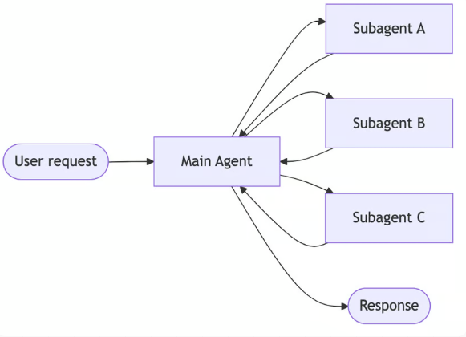
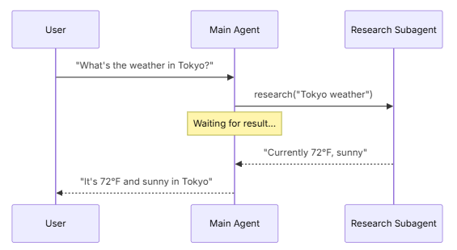
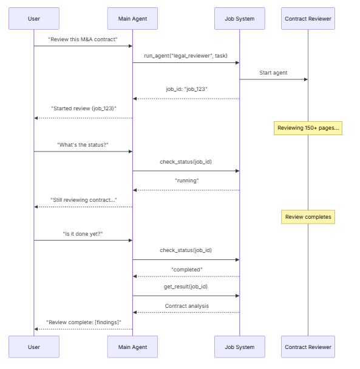
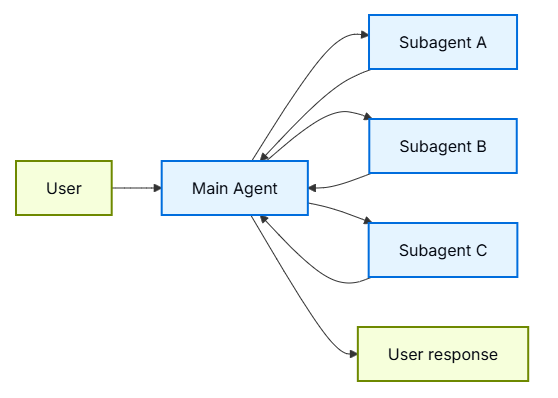
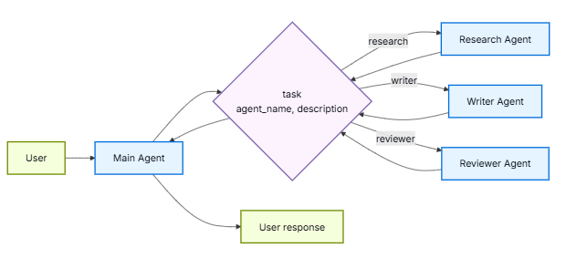

import Tabs from '@theme/Tabs';
import TabItem from '@theme/TabItem';

# Subagents

在subagent架构中，中央main agent(通常称为主管)通过将subagent称为工具来协调它们。main agent决定调用哪个subagent、提供什么输入以及如何组合结果。默认情况下，
subagent是无状态的——它们不记得过去的交互，所有的对话记忆都由main agent维护。这提供了上下文隔离：每个subagent调用都在一个干净的上下文窗口中工作，防止主对话中的上下文膨胀。

当subagent需要该上下文时，你还可以将main agent的对话历史传递给subagent。请参阅subagent输入。有关内置的subagent支持，请参阅deep agent。
<center>  </center> 

## Key characteristics

- 集中控制：所有路由都通过main agent
- 没有直接的用户交互：subagent将结果返回给main agent，而不是用户(尽管您可以在subagent中使用中断来允许用户交互)
- 通过工具调用subagent：subagent通过工具调用
- 并行执行：main agent可以在一次循环中调用多个subagent

Supervisor与Router：supervisor(这种模式)与Router不同。supervisor是一个完整的agent，负责维护对话上下文，并动态决定在多个回合中呼叫哪些sunagent。router通常是一个单一的分类步骤，
在不维护正在进行的对话状态的情况下分派给agent。

## When to use

当你有多个不同的域（例如日历、电子邮件、CRM、数据库），subagents不需要直接与用户对话，或者你想要集中的工作流控制时，请使用subagents模式。对于仅使用少数工具的简单情况，请使用单个agent。

需要subagent内的用户交互吗？虽然subagent通常将结果返回给mainagent，而不是直接与用户对话，但你可以在subagent中使用中断来暂停执行并收集用户输入。当subagent在继续之前需要澄清或批准时，这很有用。
main agent仍然是编排器，但subagent可以在mid-task从用户那里收集信息。

## Basic implementation

核心机制将subagent封装为main agent可以调用的工具：
```python
from langchain.tools import tool
from langchain.agents import create_agent

# Create a subagent
subagent = create_agent(model="google_genai:gemini-3.6-flash", tools=[...])

# Wrap it as a tool
@tool("research", description="Research a topic and return findings")
def call_research_agent(query: str):
    result = subagent.invoke({"messages": [{"role": "user", "content": query}]})
    return result["messages"][-1].content

# Main agent with subagent as a tool
main_agent = create_agent(model="google_genai:gemini-3.6-flash", tools=[call_research_agent])
```

## Design decisions

在实现subagent模式时，你将做出几个关键的设计选择。本表总结了各种选项，下文将详细介绍每种选项。
| Decision | Options  |
|---|---|
|  Sync vs. async  |  Sync (blocking) vs. async (background)   |
|  Tool patterns   |  Tool per agent vs. single dispatch tool  |
|  Subagent specs  |  System prompt vs. enum constraint vs. tool-based discovery (single dispatch tool only) |
|  Subagent inputs |  Query only vs. full context              |
|  Subagent outputs|  Subagent result vs full conversation history |

##  Sync vs. async

subagent执行可以是同步(阻塞)或异步(后台)。你的选择取决于main agent是否需要结果继续。
| Mode  |   Main agent behavior      |  Best for                  |   Tradeoff       |
|---|---|---|---|
| Sync  |   等待subagent完成          | main agent需要结果才能继续  | 简单，但阻塞会话   |
| Async |   在subagent在后台运行时继续 | 独立任务，用户不应该等待     | 响应迅速，但更复杂 |

### Synchronous (default)

默认情况下，subagent调用是同步的：main agent在继续之前等待每个subagent完成。当main agent的下一个操作取决于subagent的结果时，使用同步。
<center>  </center> 

When to use sync:
- main agent需要subagent的结果来制定其响应
- 任务具有顺序依赖关系（例如，获取数据→ 分析→ 响应）
- subagent故障应阻止main agent的响应

Tradeoffs:
- 简单的实现——只需调用并等待
- 在所有subagent完成之前，用户看不到任何响应
- 长时间运行的任务会冻结对话

### Asynchronous

当subagent的工作是独立的时，使用异步执行——main agent不需要结果来继续与用户对话。main agent启动后台工作并保持响应。
<center>  </center> 

When to use async:
- subagent工作独立于主对话流
- 用户应该能够在工作时继续聊天
- 你想并行运行多个独立任务

Three-tool pattern:
1. Start job: 启动后台任务，返回任务ID
2. Check status: 返回当前状态(pending, running, completed, failed)
3. Get result: 检索已完成的结果

Handling job completion：当作业完成时，你的应用程序需要通知用户。一种方法是：显示一个通知，点击后会发送一条HumanMessage，如“检查job_123并总结结果”


## Tool patterns

将subagent作为工具公开有两种主要方式：
| Pattern  |     Best for       |   Tradeoff       |
|---|---|---|
| Tool per agent       |   对每个subagent的输入/输出进行细粒度控制     | More setup, but more customization   |
| single dispatch tool |   许多agent、分布式团队、约定优于配置         | Simpler composition, less per-agent customization |

### Tool per agent 

<center>  </center> 

关键思想是将subagent包装为main agent可以调用的工具：
```
from langchain.tools import tool
from langchain.agents import create_agent

# Create a sub-agent
subagent = create_agent(model="...", tools=[...])

# Wrap it as a tool  
@tool("subagent_name", description="subagent_description")
def call_subagent(query: str):
    result = subagent.invoke({"messages": [{"role": "user", "content": query}]})
    return result["messages"][-1].content

# Main agent with subagent as a tool  
main_agent = create_agent(model="...", tools=[call_subagent])
```
当main agent确定任务与subagent的描述匹配时，它会调用subagent工具，接收结果并继续编排。有关细粒度控制，请参阅上下文工程。

### Single dispatch tool

另一种方法是使用单个参数化工具为独立任务调用临时subagent。与每个subagent被包装为单独工具的工具-每个agent方法不同，这使用了一种基于约定的方法，使用单个任务工具：任务描述作为human message传递给subagent，
subagent的最终消息作为工具结果返回。

当你想在多个团队之间分发agent开发，需要将复杂任务隔离到单独的上下文窗口中，需要一种可扩展的方式来添加新agent而无需修改协调器，或者更喜欢约定而不是定制时，请使用这种方法。
这种方法以上下文工程的灵活性换取代理组合的简单性和强大的上下文隔离。

<center>  </center> 

主要特征：
- Single task tool：一个参数化工具，可以按名称调用任何已注册的subagent
- Convention-based invocation：按名称选择agent，任务作为human message传递，最终消息作为工具结果返回
- Team distribution：不同的团队可以独立开发和部署代理
- Agent discovery：可以通过系统提示词(列出可用agent)或通过渐进式披露(通过工具按需加载agent信息)发现subagent

这种方法的一个有趣方面是，subagent可能与main agent具有完全相同的功能。在这种情况下，调用subagent实际上是为了将上下文隔离作为主要原因——允许复杂的多步骤任务在隔离的上下文窗口中运行，
而不会使main agent的对话历史膨胀。subagent自主完成其工作，只返回一个简洁的摘要，使主线程保持专注和高效。

Agent registry with task dispatcher:
```python
from langchain.tools import tool
from langchain.agents import create_agent

# Sub-agents developed by different teams
research_agent = create_agent(
    model="gpt-5.5",
    prompt="You are a research specialist..."
)

writer_agent = create_agent(
    model="gpt-5.5",
    prompt="You are a writing specialist..."
)

# Registry of available sub-agents
SUBAGENTS = {
    "research": research_agent,
    "writer": writer_agent,
}

@tool
def task(
    agent_name: str,
    description: str
) -> str:
    """Launch an ephemeral subagent for a task.

    Available agents:
    - research: Research and fact-finding
    - writer: Content creation and editing
    """
    agent = SUBAGENTS[agent_name]
    result = agent.invoke({
        "messages": [
            {"role": "user", "content": description}
        ]
    })
    return result["messages"][-1].content

# Main coordinator agent
main_agent = create_agent(
    model="gpt-5.5",
    tools=[task],
    system_prompt=(
        "You coordinate specialized sub-agents. "
        "Available: research (fact-finding), "
        "writer (content creation). "
        "Use the task tool to delegate work."
    ),
)
```

## Context engineering

控制上下文如何在main agent及其subagent之间流动：
| Category  |     Purpose      |   Impacts       |
|---|---|---|
| Subagent specs   |   确保在应该调用subagent时调用它们             |  Main agent routing decisions   |
| Subagent inputs  |   确保subagent能够在优化的上下文中很好地执行    |  Subagent performance |
| Subagent outputs |   确保主管能够根据次级agent的结果采取行动       |  main agent performance |

另请参阅我们关于agent上下文工程的综合指南。

### Subagent specs

与subagent关联的名称和描述是main agent知道要调用哪些subagent的主要方式。这些是prompting levers——仔细选择。
- Name: main agent如何指代subagent。保持清晰和以行动为导向（例如，research_agent、code_reviewer）。
- Description: main agent了解subagent的能力。具体说明它处理什么任务以及何时使用它。

对于单分派工具设计，你还必须main agent提供有关它可以调用的sub agent的信息。你可以根据agent的数量以及你的注册表是静态还是动态，以不同的方式提供此信息：
| Method  |     Best for      |   Tradeoff       |
|---|---|---|
| System prompt enumeration   |   Small, static agent lists (< 10 agents)    |  简单，但agent更改时需要及时更新   |
| Enum constraint             |   Small, static agent lists (< 10 agents)    |  类型安全且明确，但代理更改时需要更改代码 |
| Tool-based discovery        |   Large or dynamic agent registries          |  灵活且可扩展，但增加了复杂性 |

#### System prompt enumeration

直接在main agent的系统提示词中列出可用代理。main agent将代理列表及其描述视为其指令的一部分。
When to use:
- You have a small, fixed set of agents (< 10)
- Agent registry rarely changes
- You want the simplest implementation

Example:
```python
main_agent = create_agent(
    model="...",
    tools=[task],
    system_prompt=(
        "You coordinate specialized sub-agents. "
        "Available agents:\n"
        "- research: Research and fact-finding\n"
        "- writer: Content creation and editing\n"
        "- reviewer: Code and document review\n"
        "Use the task tool to delegate work."
    ),
)
```

#### Enum constraint on dispatch tool

在调度工具的agent_name参数中添加枚举约束。这提供了类型安全，并使可用agent在工具schema中显示。
When to use:
- You have a small, fixed set of agents (< 10)
- You want type safety and explicit agent names
- You prefer schema-based validation over prompt-based guidance

Example:
```python
from enum import Enum

class AgentName(str, Enum):
    RESEARCH = "research"
    WRITER = "writer"
    REVIEWER = "reviewer"

@tool
def task(
    agent_name: AgentName,  # Enum constraint
    description: str
) -> str:
    """Launch an ephemeral subagent for a task."""
    # ...
```

#### Tool-based discovery
提供一个单独的工具(例如list_agents或search_agents)， main agent可以调用该工具按需发现可用的agent。这实现了渐进式披露，并支持动态注册表。

When to use:
- You have many agents (> 10) or a growing registry
- Agent registry changes frequently or is dynamic
- You want to reduce prompt size and token usage
- Different teams manage different agents indepen

Example:
```python
@tool
def list_agents(query: str = "") -> str:
    """List available subagents, optionally filtered by query."""
    agents = search_agent_registry(query)
    return format_agent_list(agents)

@tool
def task(agent_name: str, description: str) -> str:
    """Launch an ephemeral subagent for a task."""
    # ...

main_agent = create_agent(
    model="...",
    tools=[task, list_agents],
    system_prompt="Use list_agents to discover available subagents, then use task to invoke them."
)
```

### Subagent inputs

自定义subagent接收什么上下文来执行其任务。通过从agent的state中提取，添加在静态prompt中无法捕获的输入——完整的消息历史、先前的结果或任务元数据。
```python
from langchain.agents import AgentState
from langchain.tools import tool, ToolRuntime

class CustomState(AgentState):
    example_state_key: str

@tool("subagent1_name", description="subagent1_description")
def call_subagent1(query: str, runtime: ToolRuntime[None, CustomState]):
    # Apply any logic needed to transform the messages into a suitable input
    subagent_input = some_logic(query, runtime.state["messages"])
    result = subagent1.invoke({
        "messages": subagent_input,
        # You could also pass other state keys here as needed.
        # Make sure to define these in both the main and subagent's
        # state schemas.
        "example_state_key": runtime.state["example_state_key"]
    })
    return result["messages"][-1].content
```

some_logic控制subagent接收多少上下文。只传递任务描述（查询）可以使subagent保持隔离。传递父agent的消息历史记录（runtime.state[“messages”]）会为subagent播下先前工作的种子，
这有助于它在需要继续父agent已经开始的事情时，比如恢复PR审查或修复bug。
| Mode  |    Subagent receives      |   Best for    |   Tradeoff  |
|---|---|---|---|
| Isolated (default) |  Only the task description   |   Focused work that needs little prior context   | Context isolation, but re-derives everything the parent already did |
| Forked             |  The parent’s conversation history (and, in Deep Agents, the system prompt) |  Continuing a task the parent already started | Seeded with prior context, at the cost of a larger prompt and less isolation |


### Subagent outputs

定制main agent收到的内容，以便它做出正确的决定。两种策略：
1. Prompt the sub-agent：准确指定应返回的内容。一种常见的故障模式是，subagent执行工具调用或推理，但在其最终消息中不包含结果——提醒它，main agent只看到最终输出。
2. Format in code：在返回响应之前调整或丰富响应。例如，除了使用命令返回最终文本外，还可以传递特定的Command。

```python
from typing import Annotated
from langchain.agents import AgentState
from langchain.tools import InjectedToolCallId
from langgraph.types import Command

@tool("subagent1_name", description="subagent1_description")
def call_subagent1(
    query: str,
    tool_call_id: Annotated[str, InjectedToolCallId],
) -> Command:
    result = subagent1.invoke({
        "messages": [{"role": "user", "content": query}]
    })
    return Command(update={
        # Pass back additional state from the subagent
        "example_state_key": result["example_state_key"],
        "messages": [
            ToolMessage(
                content=result["messages"][-1].content,
                tool_call_id=tool_call_id
            )
        ]
    })
```

## Checkpointing and state inspection

默认情况下，subagent使用继承的检查指针模式——每次调用都以新状态开始，支持中断，并安全并行运行。如果你需要一个subagent在调用之间维护自己的持久对话历史，
请使用checkpointer=True（continuations模式）对其进行编译。有关模式的完整比较，请参见subgraph持久性。

由于subagent在工具函数内部被调用，LangGraph无法静态地发现它们。这意味着带有subgraph的get_state不会返回subagent状态。如果需要读取嵌套图状态(例如，在中断期间), 
请从自定义图中的节点函数调用subagent。有关每种模式如何影响状态可见性的详细信息，请参见subgraph持久性。


## 简单总结：  

这是复杂agent应用使用的模式； 如果简单应用subagent可以直接套在一个tool里，复杂应用就应该划分任务划分给不同的agent处理，处理任务时先匹配agent，再具体分派；
分派可以直接写到提示词里面，可以直接把类型定义定死， 也可以单独方法寻找匹配合适的agent， 再传递适量信息处理；

