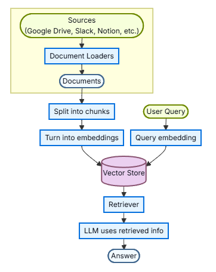
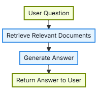
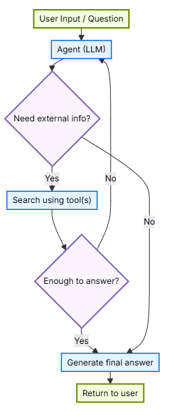
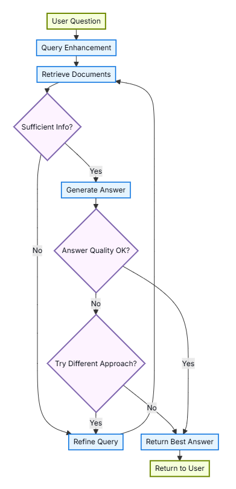

import Tabs from '@theme/Tabs';
import TabItem from '@theme/TabItem';

# Retrieval

大型语言模型（LLM）功能强大，但它们有两个关键限制：
- 有限上下文：他们不能一次摄取整个语料库。
- 静态知识：他们的训练数据在某个时间点被冻结。

检索通过在查询时获取相关的外部知识来解决这些问题。这是检索增强生成(RAG)的基础，用特定于上下文的信息增强LLM的答案。

## Building a knowledge base

知识库是检索过程中使用的文档或结构化数据的存储库。如果你需要一个自定义知识库，你可以使用LangChain的文档加载器和向量存储从你自己的数据中构建一个。

如果你已经拥有一个知识库(例如SQL数据库、文档数据库、CRM或内部文档系统)，则不需要重建它。你可以：
- 将其连接为agentic RAG中agent的tool。
- 查询它并将检索到的内容作为上下文提供给LLM(两步RAG)。


有关更多信息，请参阅以下教程，以构建可搜索的知识库和最小的RAG工作流程：

### From retrieval to RAG
检索允许LLM在运行时访问相关上下文。但大多数现实世界的应用程序更进一步：它们将检索与生成集成在一起，以产生有根据的、上下文感知的答案。

这是检索增强生成（RAG）背后的核心思想。retrieval pipeline成为将搜索与生成相结合的更广泛系统的基础。

### Retrieval pipeline
典型的检索工作流程如下：
<center>  </center>

每个组件都是模块化的：你可以更换loaders(加载器)、splitters(拆分器)、embedding(嵌入向量)、vertor(向量)，而无需重写应用逻辑。

### Building blocks

这通用的5个操作都有相应教程，这里暂时只翻译了这一个文档

## RAG architectures

RAG可以通过多种方式实现，具体取决于你的系统需求。我们在下面的章节中概述了每种类型。
|Architecture | Description  | Control |  Flexibility | Latency |
|---|---|---|---|---|
| 2-Step RAG  | 检索总是发生在生成之前。简单且可预测            |  high  | low     |  夯  |
| Agentic RAG | LLM驱动的agent决定在推理过程中何时以及如何检索  | low    |  high   |  拉  |
| Hybrid      | 将两种方法的特点与验证步骤相结合                | medium |  medium |  拉  |

Latency(延迟)：在2步RAG中，延迟通常更可预测，因为LLM调用的最大数量是已知的，并且有上限。这种可预测性假设LLM推理时间是主导因素。
然而，现实世界中的延迟也可能受到检索步骤性能的影响，如API响应时间、网络延迟或数据库查询，这些因素可能因使用的工具和基础设施而异。

### 2-step RAG

在两步RAG中，检索步骤总是在生成步骤之前执行。这种架构简单明了且可预测，使其适用于许多应用程序，在这些应用程序中，检索相关文档是生成答案的明确先决条件。
<center>  </center>

### Agentic RAG

agentic检索增强生成(RAG)将检索增强生成与基于agent的推理相结合。agent(由LLM提供支持)在交互过程中逐步推理并决定何时以及如何检索信息，而不是在回答之前检索文档。

agent启用RAG行为只需要访问一个或多个可以获取外部知识的工具，如文档加载器、web API或数据库查询。
<center>  </center>

```python
import requests
from langchain.tools import tool
from langchain.chat_models import init_chat_model
from langchain.agents import create_agent

@tool
def fetch_url(url: str) -> str:
    """Fetch text content from a URL"""
    response = requests.get(url, timeout=10.0)
    response.raise_for_status()
    return response.text

system_prompt = """\
Use fetch_url when you need to fetch information from a web-page; quote relevant snippets.
"""

agent = create_agent(
    model="claude-sonnet-4-6",
    tools=[fetch_url], # A tool for retrieval
    system_prompt=system_prompt,
)
```

### Hybrid RAG

混合RAG结合了两步RAG和agentic RAG的特点。它引入了查询预处理、检索验证和生成后检查等中间步骤。这些系统提供了比固定pipelines更大的灵活性，同时保持了对执行的一些控制。

典型组件包括：
- Query enhancement: 查询增强, 修改输入问题以提高检索质量。这可能涉及重写不清楚的查询、生成多种变体或用额外的上下文扩展查询。
- Retrieval validation: 检索验证, 评估检索到的文档是否相关且充分。如果没有，系统可以优化查询并再次检索。
- Answer validation: 答案验证：检查生成的答案的准确性、完整性以及与源内容的一致性。如果需要，系统可以重新生成或修改答案。

该架构通常支持这些步骤之间的多次迭代：
<center>  </center>

该架构适用于：
- 查询不明确或未指定的应用程序
- 需要验证或质量控制步骤的系统
- 涉及多个来源或迭代优化的工作流
