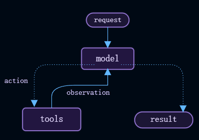
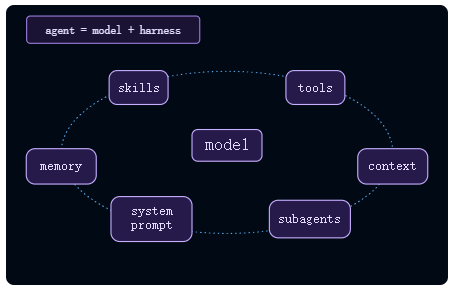

# Agents

agent是一个在循环中调用工具的模型，直到给定的任务完成。
<center>  </center>
harness是围绕该循环的一切：提示词(prompt)、工具(tool)和任何塑造模型行为的中间件(middleware)。

:::info[Agent = Model + Harness]
harness的工作：在给定任务的正确时间为模型提供正确的上下文。
:::

`create_agent`是一个高度可配置的工具。最简单的是，你可以使用以下命令创建一个：
```python
from langchain.agents import create_agent

agent = create_agent(model="openai:gpt-5.5", tools=tools) 
# 其它模型名,在购买大模型服务时请自行查询， 推荐deepseek，便宜方便
```
基于此，你可以直接使用`model=`、`tools=` 和 `system_prompt=` 参数配置基础模型。要获得更高级的功能，请使用中间件扩展harness。

:::tip[]
Managed Deep Agents基于create_agent构建，并具有已经组装好的常用功能，如规划、文件系统工具、subagent和memory。为了在使用相同的Deep Agent工具时获得最大的灵活性，
请使用Deep Agent并自己运营，或运行自定义的LangSmith部署。当你需要自己配置较小的harness时，请使用create_agent。
:::

## Core components

<center>  </center>

### Model
传递一个模型标识符字符串（“provider:model”）或一个初始化的模型实例，为你的agent选择模型。有关参数、提供程序设置和动态模型选择，请参阅模型教程。
```python
from langchain.agents import create_agent

agent = create_agent(model="openai:gpt-5.5", tools=tools)
```

### Tools
要为agent提供tool，请传递任何Python可调用函数、LangChain tool或工具字典。有关工具定义、上下文访问和动态工具选择，请参阅工具教程。
```python
from langchain.agents import create_agent
from langchain.tools import tool

@tool
def search(query: str) -> str:
    """Search for information."""
    return f"Results for: {query}"

agent = create_agent(model="openai:gpt-5.5", tools=[search])
```

### System prompt


