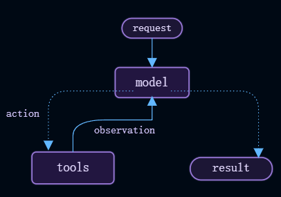
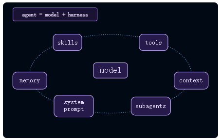
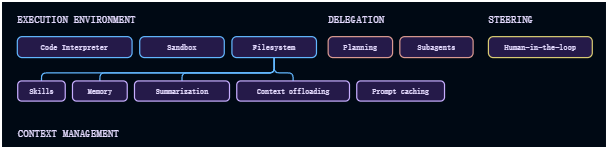

# Agents

agent是一个在循环中调用工具的模型，直到给定的任务完成。
<center>  </center>
harness是围绕该循环的一切：提示词(prompt)、工具(tool)和任何塑造模型行为的中间件(middleware)。

:::info[Agent = Model + Harness]
harness的工作：在给定任务的正确时间为模型提供正确的上下文。
:::

`create_agent`是一个高度可配置的工具。最简单的是，你可以使用以下命令创建一个：
```python
from langchain.agents import create_agent

agent = create_agent(model="openai:gpt-5.5", tools=tools) 
# 其它模型名,在购买大模型服务时请自行查询， 推荐deepseek，便宜方便
```
基于此，你可以直接使用`model=`、`tools=` 和 `system_prompt=` 参数配置基础模型。要获得更高级的功能，请使用中间件扩展harness。

:::tip[]
Managed Deep Agents基于create_agent构建，并具有已经组装好的常用功能，如规划、文件系统工具、subagent和memory。为了在使用相同的Deep Agent工具时获得最大的灵活性，
请使用Deep Agent并自己运营，或运行自定义的LangSmith部署。当你需要自己配置较小的harness时，请使用create_agent。
:::

## Core components

<center>  </center>

### Model
传递一个模型标识符字符串（“provider:model”）或一个初始化的模型实例，为你的agent选择模型。有关参数、提供程序设置和动态模型选择，请参阅模型教程。
```python
from langchain.agents import create_agent

agent = create_agent(model="openai:gpt-5.5", tools=tools)
```

### Tools
要为agent提供tool，请传递任何Python可调用函数、LangChain tool或工具字典。有关工具定义、上下文访问和动态工具选择，请参阅工具教程。
```python
from langchain.agents import create_agent
from langchain.tools import tool

@tool
def search(query: str) -> str:
    """Search for information."""
    return f"Results for: {query}"

agent = create_agent(model="openai:gpt-5.5", tools=[search])
```

### System prompt
塑造agent处理任务的方式。系统提示词参数接受字符串或SystemMessage。对于运行时的动态提示词，请使用中间件。
```python
agent = create_agent(
    model="openai:gpt-5.5",
    tools=tools,
    system_prompt="You are a helpful assistant. Be concise and accurate.",
)
```

### Structured output
使用`response_format=`从agent返回已验证的架构。有关策略和示例，请参阅结构化输出。
```python
from pydantic import BaseModel
from langchain.agents import create_agent

class Answer(BaseModel):
    summary: str
    confidence: float

agent = create_agent(model="openai:gpt-5.5", tools=tools, response_format=Answer)
result = agent.invoke({"messages": [{"role": "user", "content": "Summarize AI trends"}]})
result["structured_response"]  # Answer(summary=..., confidence=...)
```

### Agent state
每个agent都通过AgentState管理其执行上下文，`AgentState`是一个类型化字典，保存当前对话历史以及你的工具和中间件所需的任何自定义字段。

内置字段为：
| Field | Type | Description |
|---|---|---|
| messages | list[BaseMessage] | 当前线程的完整对话历史记录。仅添加：添加新消息，从不替换。  |

`AgentState`也是每个节点式中间件hook(before_model、after_model等)的类型签名。hook接收当前状态，并可以返回一个更新字典以合并回其中。

要添加自定义字段(例如，user_id或计数器)，请子类化AgentState，并通过`state_schema=`将子类传递给create_agent：
```python
from langchain.agents import AgentState, create_agent

class MyState(AgentState):
    user_id: str
    call_count: int

agent = create_agent(
    model="openai:gpt-5.5",
    tools=[],
    state_schema=MyState,
)
```

有关完整的详细信息、示例和中间件级状态模式，请参阅短期记忆和自定义中间件。


## Invocation

:::tip[]
跟踪此循环的每个步骤，调试工具调用，并使用LangSmith评估agent输出。按照跟踪快速入门进行设置。我们建议你设置LangSmith引擎，该引擎可以监视你的跟踪、检测问题并提出修复方案。
:::

你可以通过消息(message)调用agent。在幕后向agent的state传递更新消息。所有agent在其state中都包含一系列消息；
要调用agent，请传递一条新message和一个thread_id，以便agent可以持久化和恢复对话历史：
```python
from langchain.agents import create_agent
from langchain_core.utils.uuid import uuid7
from langgraph.checkpoint.memory import InMemorySaver

agent = create_agent(
    model="openai:gpt-5.5",
    tools=[],
    checkpointer=InMemorySaver(),
)

config = {"configurable": {"thread_id": str(uuid7())}}

result = agent.invoke(
    {"messages": [{"role": "user", "content": "What's the weather in San Francisco?"}]},
    config=config,
)

# A follow-up turn on the same conversation: reuse the same thread_id to keep history
result = agent.invoke(
    {"messages": [{"role": "user", "content": "What about tomorrow?"}]},
    config=config,
)
```
:::info[]
使用thread_id持久化对话历史需要为agent配置checkpointer。在LangSmith上部署时，会自动配置checkpointer。在本地，显式传递一个，
例如create_agent(...，checkpointer=InMemorySaver())。
:::

如果你还需要将per-run配置（如用户ID、API密钥或功能标志）传递给工具和中间件，请将其作为上下文与配置一起传递。使用`context_schema`定义该数据的格式，并通过`runtime.context`访问它：
```python
from dataclasses import dataclass

from langchain.agents import create_agent
from langchain_core.utils.uuid import uuid7
from langgraph.checkpoint.memory import InMemorySaver

@dataclass
class Context:
    user_id: str

agent = create_agent(
    model="openai:gpt-5.5",
    tools=[],
    context_schema=Context,
    checkpointer=InMemorySaver(),
)

result = agent.invoke(
    {"messages": [{"role": "user", "content": "What's the weather in San Francisco?"}]},
    config={"configurable": {"thread_id": str(uuid7())}},
    context=Context(user_id="user-123"),
)
```

thread_id作用于对话(message history、checkpointer)，而上下文携带你的工具和中间件在调用时读取的每次运行的数据。两者通常一起传递。有关更多信息，请参阅工具上下文和运行时。

## Streaming

invoke在运行结束时返回最终响应。如果agent执行多个工具调用，用户通常需要在完成之前更新进度。使用streaming在中间消息和工具活动发生时显示出来。
```python
from langchain.messages import AIMessage, HumanMessage

stream = agent.stream_events(
    {"messages": [{"role": "user", "content": "Search for AI news and summarize the findings"}]},
    version="v3",
)
for snapshot in stream.values:
    # Each snapshot contains the full state at that point
    latest_message = snapshot["messages"][-1]
    if latest_message.content:
        if isinstance(latest_message, HumanMessage):
            print(f"User: {latest_message.content}")
        elif isinstance(latest_message, AIMessage):
            print(f"Agent: {latest_message.content}")
    elif latest_message.tool_calls:
        print(f"Calling tools: {[tc['name'] for tc in latest_message.tool_calls]}")
```

## Configure the harness

create_agent具有高度的可扩展性。中间件是定制的基础：每个部分处理一个关注点，在适当的时候挂入agent循环，并与任何其他部分自由组合。准确把握你的用例需求，跳过其余部分。

通用模式被预构建为first-class的中间件。你可以将其他任何东西构建为自定义中间件。
<center>  </center>

随着agent承担复杂的工作，他们需要在几个关键领域得到支持。中间件生态系统提供：
- Execution environment: Tools, filesystem, sandboxes, and code execution
- Context management: Summarization, memory, skills, and prompt caching
- Planning and delegation: Todo lists and subagents for parallel, isolated work
- Fault tolerance: Retries, fallbacks, and call limits
- Guardrails: PII detection and content controls
- Steering: Human-in-the-loop approval before high-impact actions

### 执行环境
当agent可以采取行动而不仅仅是生成文本时，它们特别有用。执行环境为agent提供了一个工作区：它可以调用的工具、用于跨轮次读写文件的文件系统，以及用于运行脚本或shell命令的代码执行。
```python
from langchain.agents import create_agent
from deepagents.backends import StateBackend
from deepagents.middleware import FilesystemMiddleware

agent = create_agent(
    model="openai:gpt-5.5",
    tools=[search],
    middleware=[FilesystemMiddleware(backend=StateBackend())],
)
```

请参阅FilesystemMiddleware, Sandboxes, Interpreters.

:::info[]
此示例从deepagents包导入。使用时安装：
```python
pip install deepagents
```
:::


### 上下文管理
每个模型调用都有一个固定的上下文窗口。当agent运行时，该窗口会填充累积的历史记录、工具结果和中间步骤。摘要在溢出发生之前压缩历史记录；内存在启动时加载持久指令，
以便知识在会话中传递；skills根据需要提供领域知识，而不是预先加载所有内容。
```python
from deepagents.backends import StateBackend
from deepagents.middleware import FilesystemMiddleware, MemoryMiddleware, SkillsMiddleware, SummarizationMiddleware

backend = StateBackend()
model = "openai:gpt-5.5"

agent = create_agent(
    model=model,
    tools=[search],
    middleware=[
        FilesystemMiddleware(backend=backend),
        SummarizationMiddleware(model=model, backend=backend),
        MemoryMiddleware(backend=backend, sources=["./AGENTS.md"]),
        SkillsMiddleware(backend=backend, sources=["./skills/"]),
    ],
)
```

See <u>SummarizationMiddleware</u>, <u>MemoryMiddleware</u>, <u>Skills</u>, <u> Context engineering</u> .

:::info[]
此示例从deepagents包导入。使用时安装：
```python
pip install deepagents
```
:::


### 规划和委托
复杂的任务往往超出了一个上下文窗口的处理能力。委托(Delegation)main agent将工作分解为多个部分，将它们交给subagent，每个subagent在各自独立的环境中运行，并专注于协调而不是执行。
工作可以并行运行；main agent的上下文保持干净。
```python
from deepagents.backends import StateBackend
from deepagents.middleware import FilesystemMiddleware
from deepagents.middleware.subagents import SubAgentMiddleware
from langchain.agents import create_agent
from langchain.agents.middleware import TodoListMiddleware
from langchain.tools import tool

@tool
def search(query: str) -> str:
    """Search for a query and return a short summary."""
    return f"Search results for: {query}"

backend = StateBackend()

agent = create_agent(
    model="openai:gpt-5.5",
    tools=[search],
    middleware=[
        FilesystemMiddleware(backend=backend),
        TodoListMiddleware(),
        SubAgentMiddleware(
            backend=backend,
            subagents=[
                {
                    "name": "researcher",
                    "description": "Searches and returns a structured summary.",
                    "system_prompt": "Use the search tool to research the question and summarize key points.",
                    "tools": [search],
                    "model": "anthropic:claude-sonnet-4-6",
                    "middleware": [],
                }
            ],
        ),
    ],
)
```

See <u>Subagents</u>.

:::info[]
此示例从deepagents包导入。使用时安装：
```python
pip install deepagents
```
:::

### 命名agent
可选地为agent使用标识符。当将agent作为子图嵌入multi-agen系统时，这尤其有用。
```python
agent = create_agent(model="openai:gpt-5.5", tools=tools, name="research_assistant")
```

### 容错
生产中的agent遇到开发中很少出现的故障：速率限制、模型超时、短暂的API错误。容错中间件在基础架构级别处理这些问题，因此你的工具和业务逻辑不需要在每次调用时都try/catch。
```python
from langchain.agents import create_agent
from langchain.agents.middleware import ModelRetryMiddleware, ToolRetryMiddleware
from langchain.tools import tool

@tool
def search(query: str) -> str:
    """Search for a query and return a short summary."""
    return f"Search results for: {query}"

agent = create_agent(
    model="openai:gpt-5.5",
    tools=[search],
    middleware=[
        ModelRetryMiddleware(max_retries=3),
        ToolRetryMiddleware(max_retries=2),
    ],
)
```

See <u>ModelRetryMiddleware</u>, <u>ToolRetryMiddleware</u>, <u>Prebuilt middleware</u>.

### 护栏
有些政策不能一蹴而就——无论模型做什么，都需要果断地执行。护栏(Guardrails)在数据流经agent循环时拦截数据，在工具结果到达模型上下文之前应用合规规则或内容策略。
```python
from langchain.agents import create_agent
from langchain.agents.middleware import PIIMiddleware
from langchain.tools import tool

@tool
def search(query: str) -> str:
    """Search for a query and return a short summary."""
    return f"Search results for: {query}"

agent = create_agent(
    model="openai:gpt-5.5",
    tools=[search],
    middleware=[PIIMiddleware("email")],
)
```
See <u>PIIMiddleware</u>, <u>Prebuilt middleware</u>.

### Steering

完全自主并不总是合适的。Steering使你能够在不重组agent的情况下，在破坏性写入、昂贵的API调用或任何需要判断的事情之前，将人员置于特定的决策点。agent暂停并等待；人类批准、编辑或拒绝；执行仍在继续。
```python
from langchain.agents import create_agent
from langchain.agents.middleware import HumanInTheLoopMiddleware
from langchain.tools import tool

@tool
def search(query: str) -> str:
    """Search for a query and return a short summary."""
    return f"Search results for: {query}"

agent = create_agent(
    model="openai:gpt-5.5",
    tools=[search],
    middleware=[HumanInTheLoopMiddleware(interrupt_on={"write_file": True})],
)
```
See <u>HumanInTheLoopMiddleware</u>, <u>Human-in-the-loop</u>.


最后需要一个完整的例子，包含模型、工具、state、记忆、结构化输出的例子