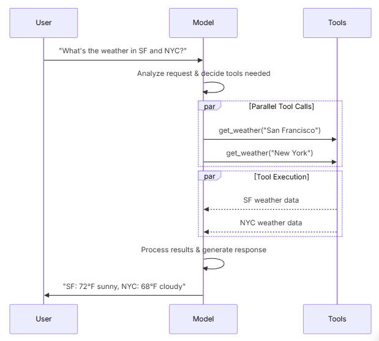

import Tabs from '@theme/Tabs';
import TabItem from '@theme/TabItem';


# 模型

LLM是强大的人工智能工具，可以像人类一样解释和生成文本。他们足够多才多艺，可以编写内容、翻译语言、总结和回答问题，而不需要为每项任务进行专门培训。

除文本生成外，许多模型还支持：
- 工具调用——调用外部工具（如数据库查询或API调用）并在响应中使用其结果。
- 结构化输出——模型的响应受限于预定义的格式。
- 多模态——处理并返回除文本外的其他数据，如图像、音频和视频。
- 推理——模型通过多步推理得出结论。

模型是智能体的推理引擎。它们驱动智能体的决策过程，决定调用哪些工具、如何解读结果以及何时给出最终答案。

你所选模型的质量与能力会直接影响代理的基准可靠性与性能。不同模型在不同任务上表现卓越——有的擅长遵循复杂指令，有的长于结构化推理，还有些支持更大的上下文窗口以处理更多信息。

LangChain的标准模型接口让你能够轻松访问多种不同的供应商集成，便于实验和切换模型，以找到最适合你使用场景的方案。

如需了解特定供应商的集成信息与功能，请参阅供应商的聊天模型页面。

:::tip
LangSmith跟踪每个模型调用，以便你可以比较提供程序、检查工具路由和调试故障。按照跟踪快速入门进行设置。
我们建议您还设置LangSmith引擎，该引擎可以监视您的跟踪、检测问题并提出修复方案。
:::

## 基础用法

模型可以通过两种方式使用：
- 使用agent-在创建agent时可以动态指定模型。
- 独立-模型可以直接调用（在agent循环之外），用于文本生成、分类或提取等任务，而不需要agent框架。
相同的模型接口在这两种情况下都有效，这使你可以根据需要灵活地启动简单的、扩展到更复杂的基于agent的工作流。

### 初始化模型
在LangChain中开始使用独立模型的最简单方法是使用init_chat_model从你选择的聊天模型提供程序初始化一个模型（以下示例）：

```python
pip install -U "langchain[openai]"
```

```python
import os
from langchain.chat_models import init_chat_model
from langchain_openai import ChatOpenA

os.environ["OPENAI_API_KEY"] = "sk-..." # 推荐使用load_dotenv

model1 = init_chat_model("gpt-6.1-sol")  # 这两种方式都可以
model2 = ChatOpenAI(model="gpt-6.1-sol")

response = model1.invoke("Why do parrots talk?")
response = model2.invoke("Why do parrots talk?")
```
有关更多详细信息，包括如何传递模型参数的信息，请参阅init_chat_model。

### 支持的提供商和模型
LangChain通过专用的集成包支持所有主要的模型提供商。每个提供程序包都实现了相同的标准接口，因此你可以在不重写应用程序逻辑的情况下交换提供程序。
新的模型名称可以立即工作-不需要LangChain更新-因为提供程序包将模型名称直接传递给提供程序的API。

浏览支持的<a href=''>提供者的完整列表</a>，或参阅提供者和模型，了解提供者、包和模型名称在LangChain中如何协同工作的概念概述。

### 关键方法
- Invoke: 该模型将消息作为输入，并在生成完整响应后输出消息。
- Stream: 调用模型，但在实时生成输出时对其进行流式处理。
- Batch: 批量向模型发送多个请求，以提高处理效率。

:::info
除了聊天模型，LangChain还支持其他相关技术，如嵌入模型和向量存储。
有关详细信息，请参阅<a href='https://docs.langchain.com/oss/python/integrations/providers/overview'>integrations page</a>。
:::


## 参数

聊天模型采用可用于配置其行为的参数。全套支持的参数因型号和提供商而异，但标准参数包括：
- model string required :  要与提供者一起使用的特定模型的名称或标识符。你还可以使用“：”格式在单个参数中指定模型及其提供者，例如“openai:o1”。
- api_key string :  与模型的提供者进行身份验证所需的密钥。这通常在你注册访问模型时发出。通常通过设置环境变量来访问。
- temperature number :  控制模型输出的随机性。数字越大，回答越有创意；较低的值使它们更具确定性。
- max_tokens number :  限制响应中的token总数，有效地控制输出的长度。
- timeout number :  取消请求之前等待模型响应的最长时间（秒）。
- max_retries number default(6) : 如果由于网络超时或速率限制等问题导致请求失败，系统将尝试重新发送请求的最大次数。重试使用具有抖动的指数回退。
网络错误、速率限制（429）和服务器错误（5xx）会自动重试。客户端错误，如401（未经授权）或404，不会重试。对于不可靠网络上的长时间agent任务，考虑将其增加到10-15。

使用init_chat_model，将这些参数作为内联**kwargs传递：
```python
model = init_chat_model(
    "claude-sonnet-4-6",
    # Kwargs passed to the model:
    temperature=0.7,
    timeout=30,
    max_tokens=1000,
    max_retries=6,  # Default; increase for unreliable networks
)
```

### 连接韧性
LangChain聊天模型自动重试失败的API请求，并进行指数退避。默认情况下，对于网络错误、速率限制（429）和服务器错误（5xx），型号最多重试6次。401（未经授权）或404等客户端错误不会重试。

你可以在创建模型时调整max_retrys和超时，然后将该实例传递给create_agent、create_deep_agent，或单独调用它：
```python
from langchain.chat_models import init_chat_model

model = init_chat_model(
    "google_genai:gemini-3.6-flash",
    max_retries=10,  # Increase for unreliable networks (default: 6)
    timeout=120,  # Seconds; increase for slow connections
)
```

:::tip
<small>
对于不可靠网络上的长时间运行的agent graph，考虑更高的max_retrys(例如10-15)和checkpointer，以便在失败时保持进度。
</small>
:::

:::info
<small>
每个聊天模型集成可能都有额外的参数用于控制特定于提供商的功能。

例如，ChatOpenAI具有use_responses_api来指示是否使用OpenAI响应或完成api。
要查找给定聊天模型支持的所有参数，请前往<a href='https://docs.langchain.com/oss/python/integrations/chat'>chat model integrations page</a>。
</small>
:::


## 调用
必须调用聊天模型以生成输出。有三种主要的调用方法，每种方法都适合不同的用例。

### invoke
调用模型最直接的方法是将invoke()与单个消息或消息列表一起使用。
```python
response = model.invoke("Why do parrots have colorful feathers?")
print(response)
```
可以向聊天模型提供消息列表以表示对话历史。每条消息都有一个角色，模型用它来指示谁在对话中发送了消息。

有关角色、类型和内容的更多详细信息，请参阅消息指南。
```python
conversation = [
    {"role": "system", "content": "You are a helpful assistant that translates English to French."},
    {"role": "user", "content": "Translate: I love programming."},
    {"role": "assistant", "content": "J'adore la programmation."},
    {"role": "user", "content": "Translate: I love building applications."}
]

response = model.invoke(conversation)
print(response)  # AIMessage("J'adore créer des applications.")
```

```python
from langchain.messages import HumanMessage, AIMessage, SystemMessage

conversation = [
    SystemMessage("You are a helpful assistant that translates English to French."),
    HumanMessage("Translate: I love programming."),
    AIMessage("J'adore la programmation."),
    HumanMessage("Translate: I love building applications.")
]

response = model.invoke(conversation)
print(response)  # AIMessage("J'adore créer des applications.")
```

:::info
<small>
如果调用的返回类型是字符串，请确保你使用的是聊天模型，而不是LLM。传统的文本补全LLM直接返回字符串。
LangChain聊天模型前缀为“chat”，例如ChatOpenAI（/oss/integrations/chat/openai）。
</small>
:::


### stream
大多数模型可以在生成输出内容的同时进行流式传输。通过逐步显示输出，流媒体显著改善了用户体验，特别是对于较长的响应。
调用stream()返回一个迭代器，该迭代器在生成输出块时生成输出块。你可以使用循环实时处理每个块：

<Tabs>
  <TabItem value="basic text streaming" label="basic text streaming" default>
    ```python
    for chunk in model.stream("Why do parrots have colorful feathers?"):
        print(chunk.text, end="|", flush=True)
    ```
  </TabItem>
  <TabItem value="stream tool calls, reasoning, and other content" label="stream tool calls, reasoning, and other content">
    ```python
    for chunk in model.stream("What color is the sky?"):
        for block in chunk.content_blocks:
            if block["type"] == "reasoning" and (reasoning := block.get("reasoning")):
                print(f"Reasoning: {reasoning}")
            elif block["type"] == "tool_call_chunk":
                print(f"Tool call chunk: {block}")
            elif block["type"] == "text":
                print(block["text"])
            else:
                ...
    ```
  </TabItem>
</Tabs>

与invoke()不同，在模型生成完整响应后返回单个AIMessage，stream()返回多个AIMessageChunk对象，每个对象都包含输出文本的一部分。
重要的是，流中的每个块都被设计为通过求和收集成完整的消息：

```python
full = None  # None | AIMessageChunk
for chunk in model.stream("What color is the sky?"):
    full = chunk if full is None else full + chunk
    print(full.text)

# The
# The sky
# The sky is
# The sky is typically
# The sky is typically blue
# ...

print(full.content_blocks)
# [{"type": "text", "text": "The sky is typically blue..."}]
```

生成的消息可以被视为与使用invoke()生成的消息相同——例如，它可以被聚合到消息历史中，并作为会话上下文传递回模型。

### Batch
将一组独立请求批处理到一个模型可以显著提高性能并降低成本，因为处理可以并行完成：
```python
responses = model.batch([
    "Why do parrots have colorful feathers?",
    "How do airplanes fly?",
    "What is quantum computing?"
])
for response in responses:
    print(response)
```

:::info
<small>
本节描述了一个聊天模型方法batch()，它在客户端并行化模型调用。它不同于推理提供者（如OpenAI或Anthropic）支持的批处理API。
</small>
:::

默认情况下，batch()只会返回整个批处理的最终输出。如果你想在生成完成时接收每个单独输入的输出，你可以使用batch_as_completed()来流式传输结果：
```python
for response in model.batch_as_completed([
    "Why do parrots have colorful feathers?",
    "How do airplanes fly?",
    "What is quantum computing?"
]):
    print(response)
```

:::info
<small>
使用batch_as_completed()时，结果可能会乱序到达。每个都包括用于匹配的输入索引，以便根据需要重建原始顺序。
</small>
:::

:::tip
<small>
当使用batch()或batch_as_completed()处理大量输入时，你可能需要控制并行调用的最大数量。这可以通过在RunnableConfig字典中设置max_compassion属性来实现。
```python
model.batch(
    list_of_inputs,
    config={    'max_concurrency': 5,  # Limit to 5 parallel calls    }
)
```
有关支持的属性的完整列表，请参阅RunnableConfig。
</small>
:::

有关批处理的更多详细信息，请参阅<a href='https://reference.langchain.com/python/langchain-core/language_models?_gl=1*1l1sotl*_gcl_au*ODc1NjgwNzY5LjE3OTQwODM1MjQ.*_ga*MTM3MDY2NzE2My4xNzk0MDgzNTI0*_ga_47WX3HKKY2*czE3OTQ0NzA4OTQkbzM1JGcxJHQxNzk0NDc3MzI2JGo1NSRsMCRoMA..#langchain_core.language_models.chat_models.BaseChatModel.batch'>reference</a>。


## Tool calling
模型可以请求调用执行任务的工具，例如从数据库中获取数据、搜索网络或运行代码。tool是以下各项的组合：
1. schema(模式)，包括工具名称、描述和/或参数定义（通常是JSON模式）
2. 要执行的函数或协程。

:::info
<small>
你可能会听到“function calling”这个词。我们可以将其与“tool calling”互换使用。
</small>
:::

以下是用户和模型之间的基本工具调用流程：
<center>  </center>
要使你定义的工具可供模型使用，你必须使用bind_tools绑定它们。在后续调用中，模型可以根据需要选择调用任何绑定的工具。

一些模型提供者提供了可以通过模型或调用参数启用的内置工具(例如ChatOpenAI、ChatAnthropic)。有关详细信息，请查看相应的提供商参考。

:::tip
<small>
有关创建工具的详细信息和其他选项，请参阅<a href='https://docs.langchain.com/oss/python/langchain/tools'>tools guide </a>。
</small>
:::

```python
from langchain.tools import tool

@tool
def get_weather(location: str) -> str:
    """Get the weather at a location."""
    return f"It's sunny in {location}."

model_with_tools = model.bind_tools([get_weather])

response = model_with_tools.invoke("What's the weather like in Boston?")
for tool_call in response.tool_calls:
    # View tool calls made by the model
    print(f"Tool: {tool_call['name']}")
    print(f"Args: {tool_call['args']}")
```

绑定用户定义的工具时，模型的响应包括执行工具的请求。当将模型与agent分开使用时，由你执行所请求的工具并将结果返回给模型以用于后续推理。
使用agent时，agent循环将为你处理工具执行循环。

下面，我们将展示一些使用工具调用的常见方法。

- Tool execution loop
- Forcing tool calls
- Parallel tool calls
- Streaming tool calls


## 结构化输出
可以要求模型以与给定模式匹配的格式提供其响应。这有助于确保输出易于解析并在后续处理中使用。LangChain支持多种模式类型和方法来强制结构化输出。

:::info
<small>
要了解结构化输出，请参阅<a href=''>结构化输出</a>。
</small>
:::


<Tabs>
  <TabItem value="Pydantic" label="Pydantic" default>
    Pydantic模型提供了最丰富的特征集，包括字段验证、描述和嵌套结构。
    ```python
    from pydantic import BaseModel, Field

    class Movie(BaseModel):
        """A movie with details."""
        title: str = Field(description="The title of the movie")
        year: int = Field(description="The year the movie was released")
        director: str = Field(description="The director of the movie")
        rating: float = Field(description="The movie's rating out of 10")

    model_with_structure = model.with_structured_output(Movie)
    response = model_with_structure.invoke("Provide details about the movie Inception")
    print(response)  # Movie(title="Inception", year=2010, director="Christopher Nolan", rating=8.8)
    ```
  </TabItem>
  <TabItem value="TypedDict" label="TypedDict">
    Python的TypedDict为Pydantic模型提供了一种更简单的替代方案，在不需要运行时验证时非常理想。
    ```python
    from typing_extensions import TypedDict, Annotated

    class MovieDict(TypedDict):
        """A movie with details."""
        title: Annotated[str, ..., "The title of the movie"]
        year: Annotated[int, ..., "The year the movie was released"]
        director: Annotated[str, ..., "The director of the movie"]
        rating: Annotated[float, ..., "The movie's rating out of 10"]

    model_with_structure = model.with_structured_output(MovieDict)
    response = model_with_structure.invoke("Provide details about the movie Inception")
    print(response)  # {'title': 'Inception', 'year': 2010, 'director': 'Christopher Nolan', 'rating': 8.8}
    ```
  </TabItem>
  <TabItem value="JSON Schema" label="JSON Schema">
    提供JSON模式以实现最大的控制和互操作性。
    ```python
    import json

    json_schema = {
        "title": "Movie",
        "description": "A movie with details",
        "type": "object",
        "properties": {
            "title": {
                "type": "string",
                "description": "The title of the movie"
            },
            "year": {
                "type": "integer",
                "description": "The year the movie was released"
            },
            "director": {
                "type": "string",
                "description": "The director of the movie"
            },
            "rating": {
                "type": "number",
                "description": "The movie's rating out of 10"
            }
        },
        "required": ["title", "year", "director", "rating"]
    }

    model_with_structure = model.with_structured_output(
        json_schema,
        method="json_schema",
    )
    response = model_with_structure.invoke("Provide details about the movie Inception")
    print(response)  # {'title': 'Inception', 'year': 2010, ...}
    ```
  </TabItem>
</Tabs>


### 处理模型refusal
供应商将refusal（如安全政策拒绝）报告为成功的响应，而不是错误。普通模型调用返回带有拒绝内容块的消息。
with_structured_output从langchain_core.exceptions中引发ModelRefusedError，而不是解析错误。错误的raw_message包含被拒绝的响应。
```python
from langchain_core.exceptions import ModelRefusalError
model_with_structure = model.with_structured_output(Movie)

try:
    response = model_with_structure.invoke("Provide details about the movie Inception")
except ModelRefusalError as error:
    print(error)  # Model refused to produce the requested output (category='cyber'): ...
    refused = error.raw_message
```
当include_raw=True时，With_structured_output将错误作为paring_error返回，而不是引发它：
```python
model_with_structure = model.with_structured_output(Movie, include_raw=True)
response = model_with_structure.invoke("Provide details about the movie Inception")
if isinstance(response["parsing_error"], ModelRefusalError):
    refused = response["raw"]
```
LangChain检测OpenAI、Anthropic和Gemini模型的拒绝。对于agent，当您添加ModelRefusedMiddleware时，create_agent中的response_format会引发ModelRefusedError；
请参阅结构化输出和处理拒绝。


:::info
<small>
对于Gemini，拒绝处理要求langchain core>=1.7.5，langchain google genai>=4.4.3。如果您将langchain核心升级到1.7.5或更高版本，请同时升级到langchain openai>=1.7.4。
早期版本引发了响应API结构化输出拒绝的通用ValueError，而不是OpenAIRefusalError。
</small>
:::

## 高级话题

### 模型配置文件

:::info
<small>
模型配置文件要求langchain>=1.1。
</small>
:::

LangChain聊天模型可以通过配置文件属性公开支持特性和功能的字典：
```python
model.profile
# {
#   "max_input_tokens": 400000,
#   "image_inputs": True,
#   "reasoning_output": True,
#   "tool_calling": True,
#   ...
# }
```

请参阅API参考资料中的完整字段集。

大部分模型配置文件数据由models.dev项目提供支持，该项目是一个提供模型能力数据的开源项目。这些数据会添加额外的字段，以便与LangChain一起使用。
随着上游项目的发展，这些增强与上游项目保持一致

模型配置文件数据允许应用程序动态地处理模型功能。例如：
1. 摘要中间件可以根据模型的上下文窗口大小触发摘要。
2. create_agent中的结构化输出策略可以自动推断（例如，通过检查对本机结构化输出功能的支持）。
3. 模型输入可以根据支持的模式和最大输入token进行门控。
4. Deep Agents Code将交互式模型切换器筛选为配置文件报告工具调用支持和文本I/O的模型，并在选择器详细视图中显示上下文窗口大小和功能标志。


### 多模态

### 推理

### 本地模型

### Prompt caching
许多提供商提供快速缓存功能，以减少重复处理相同token的延迟和成本。你可以在三个级别使用缓存：

### token使用情况
许多模型提供程序将token使用信息作为调用响应的一部分返回。如果可用，此信息将包含在相应模型生成的AIMessage对象上。有关更多详细信息，请参阅消息指南。

你可以使用回调或上下文管理器跟踪应用程序中模型之间的聚合token计数，如下所示：
```python
from langchain.chat_models import init_chat_model
from langchain_core.callbacks import UsageMetadataCallbackHandler

model_1 = init_chat_model(model="gpt-5.4-mini")
model_2 = init_chat_model(model="claude-haiku-4-5-20251001")

callback = UsageMetadataCallbackHandler()
result_1 = model_1.invoke("Hello", config={"callbacks": [callback]})
result_2 = model_2.invoke("Hello", config={"callbacks": [callback]})
print(callback.usage_metadata)
```

这后面稀碎的边角料太多了