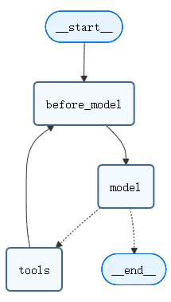
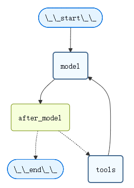

# 短期记忆


## 概览

memory是一个能记住以前交互信息的系统。对于AI Agent来说，记忆至关重要，因为它可以让他们记住之前的交互，从反馈中学习，并适应用户偏好。 
随着代理处理具有大量用户交互的更复杂的任务，这种能力对于效率和用户满意度都变得至关重要。

短期记忆让您的应用程序记住单个线程或对话中的先前交互。

会话历史是短期记忆最常见的形式。长对话对今天的大模型(LLM)提出了挑战。完整的历史记录可能无法放入LLM的上下文窗口中，从而导致上下文丢失或错误。

即使您的模型支持完整的上下文长度，大多数LLM在长上下文中的性能仍然很差。他们会被陈旧或离题的内容“分心”，同时面临响应更慢和算力消耗更大的问题。

聊天模型使用message接受上下文，其中包括指令（系统消息）和输入（人工消息）。在聊天应用程序中，消息在人工输入和模型响应之间交替，导致消息列表随着时间的推移而变长。
由于上下文窗口有限，许多应用可以从使用删除或“忘记”过时信息的技术中受益。


## 用法

要向agent添加短期记忆（线程级持久性），你需要在创建agent时指定一个checkpointer。


## 访问短期记忆

你可以通过多种方式访问和修改agent的短期记忆（状态）：

### 工具(tool)

#### 在tool中读取短期记忆

使用runtime访问tool中的短期记忆。runtime对tool signature隐藏（因此模型看不到它），但tool可以通过它访问短时记忆(状态)。

```js title=""
from langchain.agents import create_agent, AgentState
from langchain.tools import tool, ToolRuntime

class CustomState(AgentState):
    user_id: str

@tool
def get_user_info( runtime: ToolRuntime ) -> str:
    """Look up user info."""
    user_id = runtime.state["user_id"]
    return "User is John Smith" if user_id == "user_123" else "Unknown user"

agent = create_agent(
    model="gpt-5-nano",
    tools=[get_user_info],
    state_schema=CustomState,
)

result = agent.invoke({
    "messages": "look up user information",
    "user_id": "user_123"
})
print(result["messages"][-1].content)
# > User is John Smith.
```

#### 用tool写短期记忆

要在执行过程中修改agent的短期记忆(状态)，可以直接从工具返回状态更新。这对于持久化中间结果或使后续tool、prompt可以访问信息非常有用。

```js title=""
from langchain.tools import tool, ToolRuntime
from langchain_core.runnables import RunnableConfig
from langchain.messages import ToolMessage
from langchain.agents import create_agent, AgentState
from langgraph.types import Command
from pydantic import BaseModel

class CustomState(AgentState):
    user_name: str

class CustomContext(BaseModel):
    user_id: str

@tool
def update_user_info( runtime: ToolRuntime[CustomContext, CustomState], ) -> Command:
    """Look up and update user info."""
    user_id = runtime.context.user_id
    name = "John Smith" if user_id == "user_123" else "Unknown user"
    return Command(update={
        "user_name": name,
        # update the message history
        "messages": [
            ToolMessage(
                "Successfully looked up user information",
                tool_call_id=runtime.tool_call_id
            )
        ]
    })

@tool
def greet( runtime: ToolRuntime[CustomContext, CustomState] ) -> str | Command:
    """Use this to greet the user once you found their info."""
    user_name = runtime.state.get("user_name", None)
    if user_name is None:
       return Command(update={
            "messages": [
                ToolMessage(
                    "Please call the 'update_user_info' tool it will get and update the user's name.",
                    tool_call_id=runtime.tool_call_id
                )
            ]
        })
    return f"Hello {user_name}!"

agent = create_agent(
    model="gpt-5-nano",
    tools=[update_user_info, greet],
    state_schema=CustomState,
    context_schema=CustomContext,
)

agent.invoke(
    {"messages": [{"role": "user", "content": "greet the user"}]},
    context=CustomContext(user_id="user_123"),
)
```

### 提示词(prompt)

访问中间件中的短期记忆（状态），根据对话历史或自定义状态字段创建动态prompt。这里动态提示词是以中间件形式工作的！

```js
from langchain.agents import create_agent
from typing import TypedDict
from langchain.agents.middleware import dynamic_prompt, ModelRequest

class CustomContext(TypedDict):
    user_name: str

def get_weather(city: str) -> str:
    """Get the weather in a city."""
    return f"The weather in {city} is always sunny!"

@dynamic_prompt
def dynamic_system_prompt(request: ModelRequest) -> str:
    user_name = request.runtime.context["user_name"]
    system_prompt = f"You are a helpful assistant. Address the user as {user_name}."
    return system_prompt

agent = create_agent(
    model="gpt-5-nano",
    tools=[get_weather],
    middleware=[dynamic_system_prompt],
    context_schema=CustomContext,
)

result = agent.invoke(
    {"messages": [{"role": "user", "content": "What is the weather in SF?"}]},
    context=CustomContext(user_name="John Smith"),
)
for msg in result["messages"]:
    msg.pretty_print()
```

```js title='Output'
================================ Human Message =================================
What is the weather in SF?
================================== Ai Message ==================================
Tool Calls:
  get_weather (call_WFQlOGn4b2yoJrv7cih342FG)
 Call ID: call_WFQlOGn4b2yoJrv7cih342FG
  Args:
    city: San Francisco
================================= Tool Message =================================
Name: get_weather
The weather in San Francisco is always sunny!
================================== Ai Message ==================================
Hi John Smith, the weather in San Francisco is always sunny!
```
### Before model

在@before_model中间件中访问短期记忆(状态)，以便在模型调用之前处理message。

<center>  </center>

```js
from langchain.messages import RemoveMessage
from langgraph.graph.message import REMOVE_ALL_MESSAGES
from langgraph.checkpoint.memory import InMemorySaver
from langchain.agents import create_agent, AgentState
from langchain.agents.middleware import before_model
from langchain_core.runnables import RunnableConfig
from langgraph.runtime import Runtime
from typing import Any

@before_model
def trim_messages(state: AgentState, runtime: Runtime) -> dict[str, Any] | None:
    """Keep only the last few messages to fit context window."""
    messages = state["messages"]

    if len(messages) <= 3:
        return None  # No changes needed

    first_msg = messages[0]
    recent_messages = messages[-3:] if len(messages) % 2 == 0 else messages[-4:]
    new_messages = [first_msg] + recent_messages

    return {
        "messages": [
            RemoveMessage(id=REMOVE_ALL_MESSAGES),
            *new_messages
        ]
    }

agent = create_agent(
    "gpt-5-nano",
    tools=[],
    middleware=[trim_messages],
    checkpointer=InMemorySaver()
)

config: RunnableConfig = {"configurable": {"thread_id": "1"}}

agent.invoke({"messages": "hi, my name is bob"}, config)
agent.invoke({"messages": "write a short poem about cats"}, config)
agent.invoke({"messages": "now do the same but for dogs"}, config)
final_response = agent.invoke({"messages": "what's my name?"}, config)

final_response["messages"][-1].pretty_print()
"""
================================== Ai Message ==================================
Your name is Bob. You told me that earlier.
If you'd like me to call you a nickname or use a different name, just say the word.
"""
```

### After model

在@after_model中间件中访问短期记忆(状态)，以在模型调用后处理message。

<center>  </center>

```js
from langchain.messages import RemoveMessage
from langgraph.checkpoint.memory import InMemorySaver
from langchain.agents import create_agent, AgentState
from langchain.agents.middleware import after_model
from langgraph.runtime import Runtime


@after_model
def validate_response(state: AgentState, runtime: Runtime) -> dict | None:
    """Remove messages containing sensitive words."""
    STOP_WORDS = ["password", "secret"]
    last_message = state["messages"][-1]
    if any(word in last_message.content for word in STOP_WORDS):
        return {"messages": [RemoveMessage(id=last_message.id)]}
    return None

agent = create_agent(
    model="gpt-5-nano",
    tools=[],
    middleware=[validate_response],
    checkpointer=InMemorySaver(),
)
```
