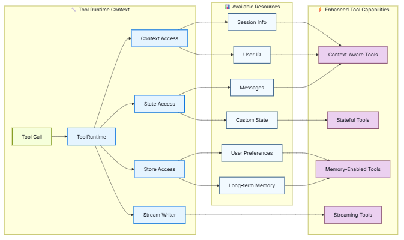

import Tabs from '@theme/Tabs';
import TabItem from '@theme/TabItem';

# 工具

工具扩展了agent可以做的事情——让他们获取实时数据、执行代码、查询外部数据库，并在真实世界上采取行动。

在底层，工具是可调用的函数，具有定义良好的输入和输出，这些输入和输出被传递给聊天模型。该模型根据对话上下文决定何时调用工具，以及提供哪些输入参数。

:::tip
<small>
有关模型如何处理工具调用的详细信息，请参阅工具调用。使用LangSmith跟踪工具调用和调试错误。按照跟踪快速入门进行设置。

我们建议你设置LangSmith引擎，该引擎可以监视您的跟踪、检测问题并提出修复方案。
</small>
:::

## 创建工具

### 基础工具定义
创建工具最简单的方法是使用@tool装饰器。默认情况下，函数的docstring成为工具的描述，帮助模型理解何时使用它：
```python
from langchain.tools import tool

@tool
def search_database(query: str, limit: int = 10) -> str:
    """Search the customer database for records matching the query.

    Args:
        query: Search terms to look for
        limit: Maximum number of results to return
    """
    return f"Found {limit} results for '{query}'"
```

类型提示是必需的，因为它们定义了工具的输入模式。文档字符串应该信息丰富且简洁，以帮助模型理解工具的目的。

:::info
<small>
服务器端工具使用：一些聊天模型具有在服务器端执行的内置工具(网络搜索、代码解释器)。有关详细信息，请参阅服务器端工具的使用。
</small>
:::

:::warning
<small>
工具名称命名为snake_case(例如，web_search而不是web search)。某些模型提供商存在问题，或拒绝包含空格或特殊字符的名称，并出现错误。坚持使用字母数字字符、下划线和连字符有助于提高提供程序之间的兼容性。
</small>
:::

### 自定义工具属性

#### 自定义工具名称
默认情况下，工具名称来自函数名称。当你需要更具描述性的内容时，请覆盖它：
```python
@tool("web_search")  # Custom name
def search(query: str) -> str:
    """Search the web for information."""
    return f"Results for: {query}"

print(search.name)  # web_search
```

#### 自定义工具描述
覆盖自动生成的工具描述，以获得更清晰的模型指导：
```python
@tool("calculator", description="Performs arithmetic calculations. Use this for any math problems.")
def calc(expression: str) -> str:
    """Evaluate mathematical expressions."""
    return str(eval(expression))
```

### 高级schema定义
使用Pydantic模型或JSON模式定义复杂的输入：
<Tabs>
  <TabItem value="Pydantic model" label="Pydantic model" default>
    ```python
    from pydantic import BaseModel, Field
    from typing import Literal

    class WeatherInput(BaseModel):
        """Input for weather queries."""
        location: str = Field(description="City name or coordinates")
        units: Literal["celsius", "fahrenheit"] = Field(
            default="celsius",
            description="Temperature unit preference"
        )
        include_forecast: bool = Field(
            default=False,
            description="Include 5-day forecast"
        )

    @tool(args_schema=WeatherInput)
    def get_weather(location: str, units: str = "celsius", include_forecast: bool = False) -> str:
        """Get current weather and optional forecast."""
        temp = 22 if units == "celsius" else 72
        result = f"Current weather in {location}: {temp} degrees {units[0].upper()}"
        if include_forecast:
            result += "\nNext 5 days: Sunny"
        return result
    ```
  </TabItem>
  <TabItem value="JSON schema" label="JSON schema">
    ```python
    weather_schema = {
        "type": "object",
        "properties": {
            "location": {"type": "string"},
            "units": {"type": "string"},
            "include_forecast": {"type": "boolean"}
        },
        "required": ["location", "units", "include_forecast"]
    }

    @tool(args_schema=weather_schema)
    def get_weather(location: str, units: str = "celsius", include_forecast: bool = False) -> str:
        """Get current weather and optional forecast."""
        temp = 22 if units == "celsius" else 72
        result = f"Current weather in {location}: {temp} degrees {units[0].upper()}"
        if include_forecast:
            result += "\nNext 5 days: Sunny"
        return result
    ```
  </TabItem>
</Tabs>


### 保留参数名

以下参数名称是保留的，不能用作工具参数。使用这些名称将导致运行时错误。
| Parameter name | Purpose |
|---|---|
| config  | Reserved for passing RunnableConfig to tools internally |
| runtime | Reserved for ToolRuntime parameter (accessing state, context, store) |

要访问运行时信息，请使用ToolRuntime参数，而不是将自己的参数命名为config或runtime。

如果使用InjectedState、InjectedStore、get_runtime（）或InjectedToolCallId，请参阅<a href='https://docs.langchain.com/oss/python/langchain/tools#migrate-from-older-injection-patterns'>从旧注入模式迁移</a>。


## 访问上下文

当工具可以访问会话历史、用户数据和持久内存等运行时信息时，它们是最强大的。本节介绍如何从工具中访问和更新此信息。

工具可以通过ToolRuntime参数访问运行时信息，该参数提供：
| Component | Description | Use case  |
|---|---|---|
| State          | Short-term memory - mutable data that exists for the current conversation (messages, counters, custom fields) | Access conversation history, track tool call counts |
| Context        | Immutable configuration passed at invocation time (user IDs, session info) | Personalize responses based on user identity |
| Store          | Long-term memory - persistent data that survives across conversations | Save user preferences, maintain knowledge base |
| Stream Writer  | Emit real-time updates during tool execution | Show progress for long-running operations |
| Execution Info | Identity and retry information for the current execution (thread ID, run ID, attempt number) | Access thread/run IDs, adjust behavior based on retry state |
| Server Info    | Server-specific metadata when running on LangSmith Agent Server (assistant ID, graph ID, authenticated user) | Access assistant ID, graph ID, or authenticated user info |
| Config         | RunnableConfig for the execution | Access callbacks, tags, and metadata |
| Tool Call ID   | Unique identifier for the current tool invocation | Correlate tool calls for logs and model invocations |

<center>  </center>

### 短期记忆(State)
状态表示在对话期间存在的短期记忆。它包括消息历史记录和你在图形状态中定义的任何自定义字段。
#### 访问状态
将runtime:ToolRuntime添加到你的工具签名中以访问状态。在调用时，ToolNode会自动注入值；该参数未包含在发送到模型的工具格式中。使用runtime.state读取当前对话状态：
```python
from langchain.tools import tool, ToolRuntime
from langchain.messages import HumanMessage

@tool
def get_last_user_message(runtime: ToolRuntime) -> str:
    """Get the most recent message from the user."""
    messages = runtime.state["messages"]

    # Find the last human message
    for message in reversed(messages):
        if isinstance(message, HumanMessage):
            return message.content

    return "No user messages found"

# Access custom state fields
@tool
def get_user_preference(
    pref_name: str,
    runtime: ToolRuntime
) -> str:
    """Get a user preference value."""
    preferences = runtime.state.get("user_preferences", {})
    return preferences.get(pref_name, "Not set")
```

:::warning
<small>
runtime参数对模型隐藏。对于上面的示例，模型只在工具sschema中看到pref_name。
</small>
:::

#### 更新状态
使用命令更新agent的状态。这对于需要更新自定义状态字段的工具非常有用。在更新中包含ToolMessage，以便模型可以看到工具调用的结果：
```python
from langchain.agents import AgentState
from langchain.messages import ToolMessage
from langchain.tools import ToolRuntime, tool
from langgraph.types import Command


class CustomState(AgentState):
    user_name: str


@tool
def set_user_name(new_name: str, runtime: ToolRuntime[None, CustomState]) -> Command:
    """Set the user's name in the conversation state."""
    return Command(
        update={
            "user_name": new_name,
            "messages": [
                ToolMessage(
                    content=f"User name set to {new_name}.",
                    tool_call_id=runtime.tool_call_id,
                )
            ],
        }
    )
```

:::tip
<small>
当工具更新状态变量时，考虑为这些字段定义一个reducer。由于LLM可以并行调用多个工具，因此当**并发**工具调用更新同一状态字段时，reducer会确定如何解决冲突。
</small>
:::

### 上下文(context)
Context提供在调用时传递的不可变配置数据。将其用于在对话过程中不应更改的用户ID、会话详细信息或特定于应用程序的设置。

:::info
<small>
虽然thread_id(通过`config={ "configurable":{"thread_id": ...} }`传递)限定了对话的范围：消息历史和checkpoints，但上下文携带了你的工具和中间件在调用时读取的每次运行的数据。
持久化需要一个checkpoints。在生产环境中，你通常会在每次对话中传递一个稳定的thread_id，并在每次调用时传递一个上下文对象。
</small>
:::

通过runtime.context访问上下文。配置一个checkpoints，并使用稳定的thread_id传递上下文，以便在调用之间保持对话：
```python
from dataclasses import dataclass

from langchain.agents import create_agent
from langchain.tools import tool, ToolRuntime
from langchain_core.utils.uuid import uuid7
from langchain_openai import ChatOpenAI
from langgraph.checkpoint.memory import InMemorySaver


USER_DATABASE = {
    "user123": {
        "name": "Alice Johnson",
        "account_type": "Premium",
        "balance": 5000,
        "email": "alice@example.com",
    },
    "user456": {
        "name": "Bob Smith",
        "account_type": "Standard",
        "balance": 1200,
        "email": "bob@example.com",
    },
}


@dataclass
class UserContext:
    user_id: str


@tool
def get_account_info(runtime: ToolRuntime[UserContext]) -> str:
    """Get the current user's account information."""
    user_id = runtime.context.user_id

    if user_id in USER_DATABASE:
        user = USER_DATABASE[user_id]
        return (
            f"Account holder: {user['name']}\n"
            f"Type: {user['account_type']}\n"
            f"Balance: ${user['balance']}"
        )
    return "User not found"


model = ChatOpenAI(model="gpt-6.1-sol")
agent = create_agent(
    model,
    tools=[get_account_info],
    context_schema=UserContext,
    checkpointer=InMemorySaver(),
    system_prompt="You are a financial assistant.",
)

thread_id = str(uuid7())
config = {"configurable": {"thread_id": thread_id}}
context = UserContext(user_id="user123")

result = agent.invoke(
    {"messages": [{"role": "user", "content": "What's my current balance?"}]},
    config=config,
    context=context,
)
print(result["messages"][-1].content_blocks)

result = agent.invoke(
    {"messages": [{"role": "user", "content": "What was my balance again?"}]},
    config=config,
    context=context,
)
print(result["messages"][-1].content_blocks)
```

### 长期记忆(Store)
BaseStore提供跨对话的持久存储。与状态(短期记忆)不同，保存到存储中的数据在未来的会话中仍然可用

通过runtime.store访问store。该存储使用命名空间/密钥模式来组织数据：

:::tip
<small>
对于生产部署，使用持久存储实现，如PostgresStore、MongoDBStore或RedistStore，而不是InMemoryStore。有关设置的详细信息，请参阅<a href='https://docs.langchain.com/oss/python/langgraph/add-memory'> memory documentation</a>。
</small>
:::

```python
from langgraph.store.memory import InMemoryStore
from langchain.agents import create_agent
from langchain.tools import tool, ToolRuntime
from langchain_openai import ChatOpenAI

# Access memory
@tool
def get_user_info(user_id: str, runtime: ToolRuntime) -> str:
    """Look up user info."""
    store = runtime.store
    user_info = store.get(("users",), user_id)
    return str(user_info.value) if user_info else "Unknown user"

# Update memory
@tool
def save_user_info(user_id: str, name: str, age: int, email: str, runtime: ToolRuntime) -> str:
    """Save user info."""
    store = runtime.store
    store.put(("users",), user_id, {"name": name, "age": age, "email": email})
    return "Successfully saved user info."

model = ChatOpenAI(model="gpt-6.1-sol")

store = InMemoryStore()
agent = create_agent(
    model,
    tools=[get_user_info, save_user_info],
    store=store
)

# First session: save user info
agent.invoke({
    "messages": [{"role": "user", "content": "Save the following user: userid: abc123, name: Foo, age: 25, email: foo@langchain.dev"}]
})

# Second session: get user info
agent.invoke({
    "messages": [{"role": "user", "content": "Get user info for user with id 'abc123'"}]
})
# Here is the user info for user with ID "abc123":
# - Name: Foo
# - Age: 25
# - Email: foo@langchain.dev
```

### 流式写入(Stream writer)
在执行过程中从工具流式传输实时更新。这对于在长时间运行的操作期间向用户提供进度反馈非常有用。

使用runtime.stream_writer发出自定义更新：
```python
from langchain.tools import tool, ToolRuntime

@tool
def get_weather(city: str, runtime: ToolRuntime) -> str:
    """Get weather for a given city."""
    writer = runtime.stream_writer

    # Stream custom updates as the tool executes
    writer(f"Looking up data for city: {city}")
    writer(f"Acquired data for city: {city}")

    return f"It's always sunny in {city}!"
```

:::info
<small>
如果在工具中使用runtime.stream_writer，则必须在LangGraph执行上下文中调用该工具。有关更多详细信息，请参阅<a href='https://docs.langchain.com/oss/python/langchain/streaming'>Streaming</a>。
</small>
:::


### 执行信息
通过runtime.execution_info从工具中访问线程ID、运行ID和重试状态：
```python
from langchain.tools import tool, ToolRuntime

@tool
def log_execution_context(runtime: ToolRuntime) -> str:
    """Log execution identity information."""
    info = runtime.execution_info
    print(f"Thread: {info.thread_id}, Run: {info.run_id}")  
    print(f"Attempt: {info.node_attempt}")
    return "done"
```

:::info
<small>
要求 deepagents>=0.5.0 (or langgraph>=1.1.5).
</small>
:::

### 服务器信息
当你的工具在agent服务器上运行时，通过runtime.Server_info访问助手ID、图形ID和经过身份验证的用户：
```python
from langchain.tools import tool, ToolRuntime

@tool
def get_assistant_scoped_data(runtime: ToolRuntime) -> str:
    """Fetch data scoped to the current assistant."""
    server = runtime.server_info
    if server is not None:
        print(f"Assistant: {server.assistant_id}, Graph: {server.graph_id}")  
        if server.user is not None:
            print(f"User: {server.user.identity}")  
    return "done"
```

当工具未在agent服务器上运行时(例如，在本地开发或测试期间)，server_info为None。

:::info
<small>
要求 deepagents>=0.5.0 (or langgraph>=1.1.5).
</small>
:::


## 工具执行
在LangChain中，工具由agent使用(例如通过create_agent)，工具错误处理通过中间件配置。

对于LangGraph工作流，工具执行由ToolNode处理。请参阅ToolNode了解图形API的用法，包括工具如何访问当前图形状态和运行范围的上下文。

### 工具返回值
你可以为工具选择不同的返回值：
- 返回一个字符串以获得人类可读的结果。
- 返回模型应解析的结构化结果的对象。
- 当你需要写入状态时，返回一个带有可选消息的command

#### 返回字符串
当工具应该为模型提供纯文本以供其在下一个响应中读取和使用时，返回一个字符串。
```python
from langchain.tools import tool

@tool
def get_weather(city: str) -> str:
    """Get weather for a city."""
    return f"It is currently sunny in {city}."
```
行为：
- 返回值转换为ToolMessage。
- 模型看到该文本并决定下一步做什么。
- 除非模型或其他工具稍后更改，否则不会更改agent状态字段。
当结果是自然可读的文本时，使用此选项。

#### 返回对象
当你的工具生成模型应该检查的结构化数据时，返回一个对象(例如dict)。
```python
from langchain.tools import tool

@tool
def get_weather_data(city: str) -> dict:
    """Get structured weather data for a city."""
    return {
        "city": city,
        "temperature_c": 22,
        "conditions": "sunny",
    }
```
行为：
- 对象被序列化并作为工具输出发回。
- 该模型可以读取特定字段并对其进行推理。
- 与字符串返回一样，这不会直接更新图状态。
当下游推理受益于显式字段而不是自由格式文本时，请使用此选项。

#### 返回多模态内容
工具不限于纯文本。当模型支持多模态工具结果时，该工具可以返回标准内容块，以便模型在一个工具结果中接收文本、图像和其他媒体。
```python
from langchain.tools import tool

@tool
def capture_screenshot() -> list[dict]:
    """Capture a screenshot of the current page."""
    return [
        {"type": "text", "text": "Screenshot of the current page:"},
        {"type": "image", "url": "https://example.com/page.png"},
    ]
```

行为：
- 返回值转换为具有多模态内容的ToolMessage。
- 在工具运行后，使用message.content_blocks读取规范化的块列表。
- 模型必须支持你返回的模式。在返回图像、音频或视频之前，请检查模型的功能。
有关块类型和特定于提供程序的要求，请参阅多模态消息。

返回图像或混合内容的MCP工具以相同的方式进行转换。请参阅多模态内容。

#### 返回命令
当工具需要更新图形状态时(例如，设置用户首选项或应用程序状态)，返回命令。当命令以当前图形为目标时，在更新中包含一个工具调用ID与当前工具调用匹配的ToolMessage。
消息历史记录中的每个工具调用都必须有一个相应的ToolMessage

将runtime.tool_call_id用作tool_call_id参数。ToolNode强制执行此要求：如果更新没有与工具调用匹配的ToolMessage，则会引发ValueError。
```python
from langchain.messages import ToolMessage
from langchain.tools import ToolRuntime, tool
from langgraph.types import Command


@tool
def set_language(language: str, runtime: ToolRuntime) -> Command:
    """Set the preferred response language."""
    return Command(
        update={
            "preferred_language": language,
            "messages": [
                ToolMessage(
                    content=f"Language set to {language}.",
                    tool_call_id=runtime.tool_call_id,
                )
            ],
        }
    )
```
行为：
- 该命令使用update更新状态。
- 更新状态可用于同一运行中的后续步骤。
- 对于可能通过并行工具调用更新的字段，请使用reducer。
当工具不仅要返回数据，还要修改agent state时，请使用此功能


## 动态工具选择

## Headless tools
有些工具应该在用户应用程序运行的地方（通常是浏览器）运行，而不是在流程中运行。
无头工具是工具定义，包括名称、描述和参数架构，你可以在服务器上向agent注册。该实现仅在客户端上注册，并在短暂的中断/恢复握手后执行。


## Prebuilt tools


## Tools from MCP servers

## Server-side tool use


